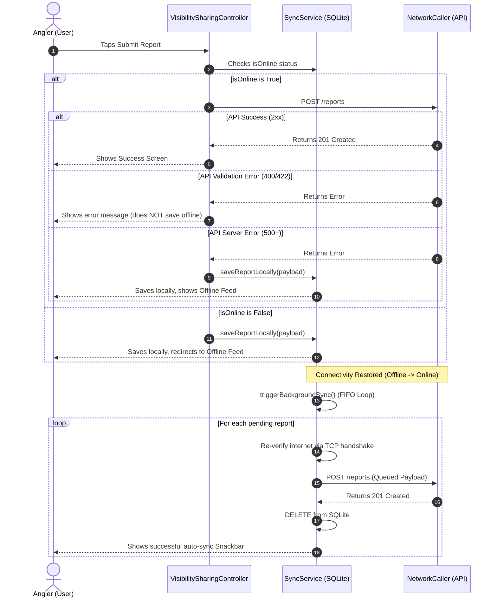
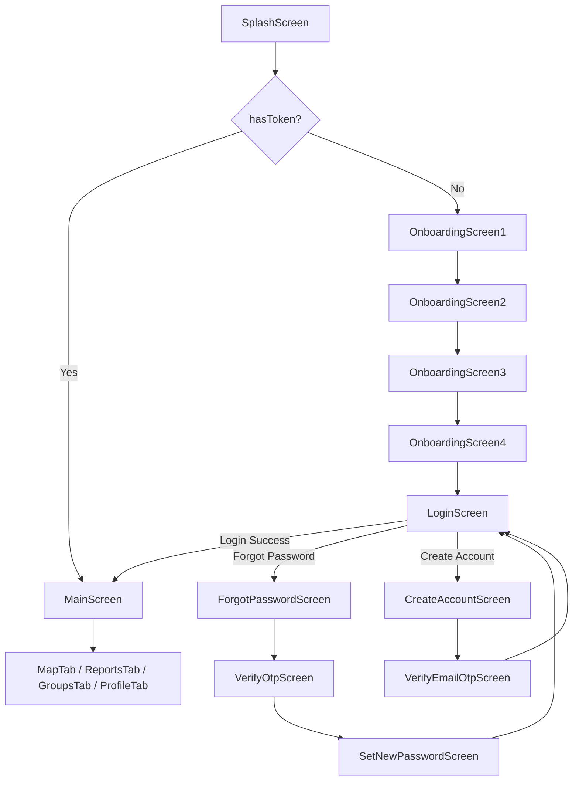
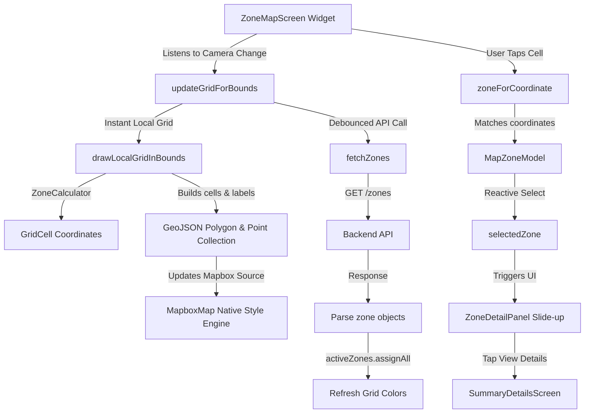
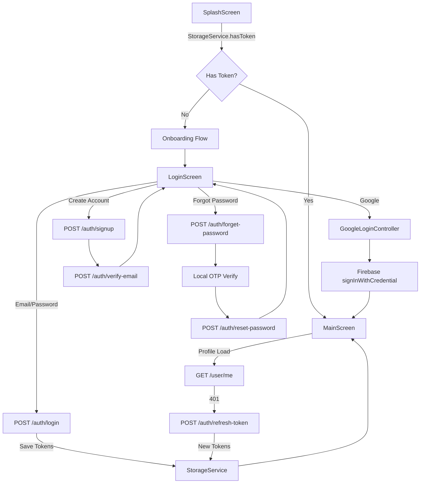
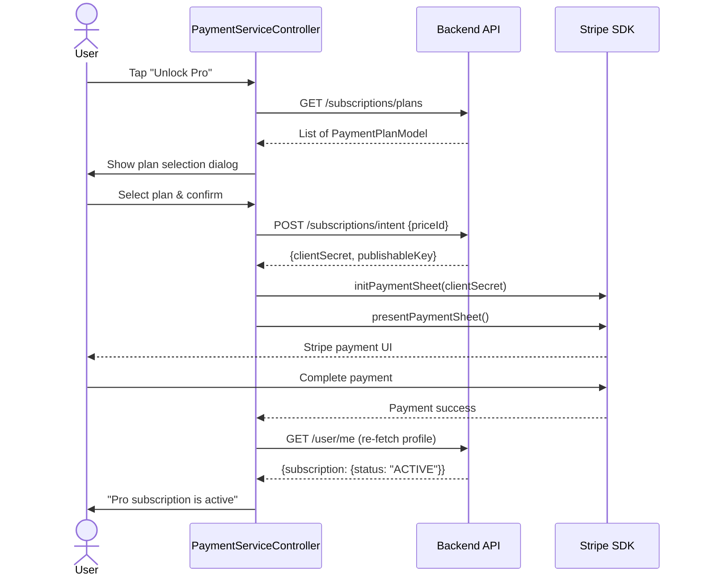

# PaytonPieper Project — Complete Analysis & API Tracking

> **Last Updated**: 2026-07-11T10:43:00+06:00  
> **Analyzer**: AI Deep Scan — Full Source Code Review  
> **Base URL**: `http://172.252.13.68:8000/api/v1`  
> **Socket URL**: `http://172.252.13.68:8000` (derived by stripping `/api/v1`)

---

## Table of Contents

1. [Project Architecture Overview](#1-project-architecture-overview)
2. [Core Services Layer](#2-core-services-layer)
3. [Authentication Flow](#3-authentication-flow)
4. [Profile & Settings Flow](#4-profile--settings-flow)
5. [Group Management Flow](#5-group-management-flow)
6. [Group Invitation Flow](#6-group-invitation-flow)
7. [Group Chat (WebSocket) Flow](#7-group-chat-websocket-flow)
8. [Report Submission Flow](#8-report-submission-flow)
9. [Offline Sync Flow](#9-offline-sync-flow)
10. [Map Screen & Zone Flow](#10-map-screen--zone-flow)
11. [Summary & Intelligence Flow](#11-summary--intelligence-flow)
12. [Weather Integration Flow](#12-weather-integration-flow-external)
13. [Bite Confirmation Flow](#13-bite-confirmation-flow)
14. [Payment & Subscription Flow](#14-payment--subscription-flow)
15. [Notification Flow](#15-notification-flow)
16. [Navigation & Routing Architecture](#16-navigation--routing-architecture)
17. [Complete API Endpoint Registry](#17-complete-api-endpoint-registry)
18. [Incomplete Features & Future Enhancements](#18-incomplete-features--future-enhancements)
19. [Architecture Diagrams](#19-architecture-diagrams)

---

## 1. Project Architecture Overview

**Framework**: Flutter (Dart) with **GetX** for state management, dependency injection, and routing.

### Directory Structure

```
lib/
├── main.dart                           # App entry point — StorageService.init(), runApp()
├── app.dart                            # GetMaterialApp wrapper — theme, routes, bindings
├── firebase_options.dart               # Firebase config (auto-generated)
├── core/
│   ├── bindings/controller_binder.dart # Global GetX controller registration
│   ├── common/
│   │   ├── styles/                     # Global text styles
│   │   └── widgets/                    # Shared widgets (CommonMessage, CustomButton, etc.)
│   ├── models/
│   │   ├── response_data.dart          # ResponseData model (isSuccess, statusCode, responseData, errorMessage)
│   │   └── species_node.dart           # Hierarchical species taxonomy model
│   ├── services/
│   │   ├── network_caller.dart         # HTTP client (GET, POST, PATCH, DELETE, multipart)
│   │   ├── storage_service.dart        # SharedPreferences wrapper (tokens, userId)
│   │   ├── sync_service.dart           # Offline SQLite queue + background sync
│   │   ├── firebase/                   # FCM push notification service
│   │   └── permissions/                # Location permission handler
│   ├── utils/
│   │   ├── constants/
│   │   │   ├── api_constants.dart      # ALL API endpoint URLs
│   │   │   ├── colors.dart             # App color palette
│   │   │   ├── enums.dart              # Global enums
│   │   │   ├── icon_path.dart          # SVG/PNG icon paths
│   │   │   ├── image_path.dart         # Image asset paths
│   │   │   └── sizer.dart              # Responsive sizing
│   │   ├── device/                     # Device utilities
│   │   ├── formatters/                 # Input formatters
│   │   ├── helpers/                    # Misc helpers
│   │   ├── logging/logger.dart         # AppLoggerHelper (info/warning/error)
│   │   ├── mapbox_config.dart          # Mapbox access token
│   │   ├── theme/                      # App theming
│   │   └── validators/                 # Input validation
│   ├── localization/                   # Internationalization files
│   ├── datetime_formate               # Date/Time formatting
│   └── websoketMathod/websoket.dart   # Legacy WebSocket (FULLY COMMENTED OUT — replaced by socket_io)
├── features/
│   ├── authentication/                 # Login, Register, Forgot Password, Google/Apple login
│   ├── groups/                         # Group CRUD, Invitations, Chat, Members
│   ├── main_screen/                    # Bottom nav host (Map, Reports, Groups, Profile tabs)
│   ├── map/                            # Mapbox satellite heatmap with 8×8mi grid
│   ├── notification/                   # Notification center (static mock)
│   ├── onboarding/                     # 4-screen onboarding flow
│   ├── payment_service/                # Stripe subscription payment
│   ├── profile_and_setting/            # Profile CRUD, Settings, Subscription plans UI
│   ├── report_main/                    # Reports feed, Summary, Weather, Offline reports, Catch form
│   ├── splash_screen/                  # App splash
│   ├── submit_report/                  # Visibility/sharing selection + submission
│   └── success_submit_report/          # Post-submission success + report detail view
├── routes/app_routes.dart              # Named route registry
└── utils/zone_calculator.dart          # Mathematical zone ID ↔ lat/lng converter
```

### Key Packages
| Package | Purpose |
|:---|:---|
| `get` | State management, routing, dependency injection |
| `http` | HTTP networking |
| `mapbox_maps_flutter` | Mapbox satellite map rendering |
| `sqflite` | Local SQLite offline storage |
| `shared_preferences` | Token/userId persistence |
| `firebase_auth` | Google Sign-In via Firebase |
| `google_sign_in` | Google OAuth |
| `flutter_stripe` | Stripe payment sheet |
| `socket_io_client` | Real-time group chat |
| `connectivity_plus` | Network connectivity monitoring |
| `fl_chart` | Bar/pie charts in Summary tab |
| `image_picker` | Gallery image selection |
| `flutter_easyloading` | Loading HUD overlays |

---

## 2. Core Services Layer

### 2.1 NetworkCaller — [network_caller.dart](file:///Users/betopia/kamrul's Project/paytonpieper/lib/core/services/network_caller.dart)

Central HTTP client used by all controllers. Supports:

| Method | Function | Content-Type |
|:---|:---|:---|
| **GET** | `getRequest(url, token?)` | `application/json` |
| **POST** | `postRequest(url, body?, token?)` | `application/json` |
| **PATCH** | `patchRequest(url, body?, token?)` | `application/json` |
| **DELETE** | `deleteRequest(url, token?)` | `application/json` |
| **POST Multipart** | `postMultipartRequest(url, fields?, file?, token?)` | `multipart/form-data` |
| **PATCH Multipart** | `patchMultipartRequest(url, fields?, file?, token?)` | `multipart/form-data` |

**Timeout**: 30 seconds per request.

**Response Handling** (`_handleResponse`):
- `200-299` → `ResponseData(isSuccess: true, responseData: decoded_json)`
- `400` → Extracts `errorSources[].message` array or `message` field
- `500` → Returns `message` or fallback `"An unexpected error occurred!"`
- Other codes → Returns `message` from body or raw string

**Error Handling** (`_handleError`):
- `ClientException` → `"Network error occurred. Please check your connection."` (statusCode: 500)
- `TimeoutException` → `"Request timeout. Please try again later."` (statusCode: 408)
- Other → `"Unexpected error occurred."` (statusCode: 500)

**Security**: Sensitive fields (`password`, `otp`, `accessToken`, `refreshToken`) are redacted in logs via `_redactSensitiveData`.

### 2.2 StorageService — [storage_service.dart](file:///Users/betopia/kamrul's Project/paytonpieper/lib/core/services/storage_service.dart)

SharedPreferences wrapper with singleton pattern:
- **Keys**: `token` (accessToken), `refreshToken`, `userId`
- **Methods**: `saveToken()`, `saveAuthTokens()`, `saveUserId()`, `logoutUser()` (clears all), `hasToken()`
- **Getters**: `token`, `refreshToken`, `userId`

### 2.3 ResponseData Model — [response_data.dart](file:///Users/betopia/kamrul's Project/paytonpieper/lib/core/models/response_data.dart)

```dart
class ResponseData {
  bool isSuccess;
  int statusCode;
  dynamic responseData;
  String errorMessage;
}
```

---

## 3. Authentication Flow

### 3.1 Create Account

**Controller**: [CreateAccountScreenController](file:///Users/betopia/kamrul's Project/paytonpieper/lib/features/authentication/controllers/create_account_screen_controller.dart)

#### Step 1: Register Account

| Field | Value |
|:---|:---|
| **Endpoint** | `POST /auth/signup` |
| **Request Body** | `{"name": "string", "email": "string", "password": "string"}` |
| **Success Response** | `{"message": "Registration successful. Please check your email."}` |
| **Error Response** | `{"errorSources": [{"message": "..."}], "message": "..."}` |
| **On Success** | Navigates to `VerifyEmailOtpScreen` |
| **Validation** | Name required, valid email, password ≥ 6 chars, confirm password match |

#### Step 2: Verify Email OTP

| Field | Value |
|:---|:---|
| **Endpoint** | `POST /auth/verify-email` |
| **Request Body** | `{"email": "registered_email", "otp": "6_digit_code"}` |
| **Success Response** | `{"message": "Email verified successfully."}` |
| **On Success** | Navigates to LoginScreen (`Get.offAllNamed`) |

---

### 3.2 Login

**Controller**: [LoginController](file:///Users/betopia/kamrul's Project/paytonpieper/lib/features/authentication/controllers/login_controller.dart)

| Field | Value |
|:---|:---|
| **Endpoint** | `POST /auth/login` |
| **Request Body** | `{"email": "string", "password": "string"}` |
| **Success Response** | `{"data": {"accessToken": "jwt_string", "refreshToken": "jwt_string"}}` |
| **On Success** | Saves both tokens via `StorageService.saveAuthTokens()`, requests location permission, navigates to `MainScreen` |
| **Validation** | Valid email, password ≥ 8 chars |

---

### 3.3 Google Sign-In

**Controller**: [GoogleLoginController](file:///Users/betopia/kamrul's Project/paytonpieper/lib/features/authentication/controllers/google_login_controller.dart)

| Field | Value |
|:---|:---|
| **Flow** | Google Sign-In SDK → Firebase `signInWithCredential` → navigates to `MainScreen` |
| **No backend API call** | Uses Firebase Auth directly (no `/auth/google` endpoint yet) |
| **Tokens Captured** | Google `idToken`, Google `accessToken`, Firebase `idToken` |

---

### 3.4 Forgot Password (3-Step)

**Controller**: [ForgotPasswordScreenController](file:///Users/betopia/kamrul's Project/paytonpieper/lib/features/authentication/controllers/forgot_password_screen_controller.dart)

#### Step 1: Send OTP

| Field | Value |
|:---|:---|
| **Endpoint** | `POST /auth/forget-password` |
| **Request Body** | `{"email": "string"}` |
| **Success Response** | `{"message": "OTP sent to your email."}` |
| **On Success** | Navigates to `VerifyOtpScreen` |

#### Step 2: Verify OTP (Local Only)

- Validates 6-digit OTP entered by user
- **No API call** — navigates to `SetNewPasswordScreen`

#### Step 3: Reset Password

| Field | Value |
|:---|:---|
| **Endpoint** | `POST /auth/reset-password` |
| **Request Body** | `{"otp": "6_digit_code", "email": "stored_email", "newPassword": "string"}` |
| **Success Response** | `{"message": "Password reset successfully."}` |
| **On Success** | Clears state, navigates to LoginScreen |
| **Validation** | Password ≥ 8 chars |

---

## 4. Profile & Settings Flow

**Controller**: [ProfileMainScreenController](file:///Users/betopia/kamrul's Project/paytonpieper/lib/features/profile_and_setting/controller/profile_main_screen_controller.dart)

### 4.1 Fetch User Profile (Auth Me)

| Field | Value |
|:---|:---|
| **Endpoint** | `GET /user/me` |
| **Headers** | `Authorization: Bearer {accessToken}` |
| **Success Response** | `{"data": {"userId": "uuid", "name": "string", "email": "string", "profileImage": "url", "subscription": {...}}}` |
| **Auto-Retry** | If initial request fails, attempts token refresh then retries |
| **On Success** | Parses into `AuthMeModel`, saves `userId` to `StorageService` |

### 4.2 Refresh Access Token

| Field | Value |
|:---|:---|
| **Endpoint** | `POST /auth/refresh-token` |
| **Request Body** | `{"userId": "uuid", "refreshToken": "jwt_string"}` |
| **Success Response** | `{"data": {"accessToken": "new_jwt", "refreshToken": "new_jwt"}}` |
| **Fallback** | If `userId` is missing from storage, extracts from JWT `sub` claim |

### 4.3 Update Profile

| Field | Value |
|:---|:---|
| **Endpoint** | `PATCH /user/profile-update` |
| **Content-Type** | `multipart/form-data` |
| **Fields** | `userName: "string"` |
| **File** | `file: image_file` (optional) |
| **On Success** | Closes dialog, re-fetches `getAuthMe()` |

### 4.4 Logout

- **No API call** — purely local: `StorageService.logoutUser()` → clears SharedPreferences → navigates to LoginScreen.

---

## 5. Group Management Flow

### 5.1 Fetch Group List

**Controller**: [GroupMainScreenController](file:///Users/betopia/kamrul's Project/paytonpieper/lib/features/groups/controller/group_main_screen_controller.dart)

| Field | Value |
|:---|:---|
| **Endpoint** | `GET /groups` |
| **Headers** | `Authorization: Bearer {accessToken}` |
| **Success Response** | `{"data": [{"id": "uuid", "name": "string", "description": "string", "photo": "url", "isPrivate": bool, "memberCount": int, "createdBy": "uuid", ...}]}` |
| **Parses Into** | `List<GroupListItem>` via `GroupListItem.fromJson()` |

### 5.2 Fetch Single Group Details

**Controller**: [GroupDetailsScreenController](file:///Users/betopia/kamrul's Project/paytonpieper/lib/features/groups/controller/group_details_screen_controller.dart)

| Field | Value |
|:---|:---|
| **Endpoint** | `GET /groups/{groupId}` |
| **Headers** | `Authorization: Bearer {accessToken}` |
| **Success Response** | `{"data": {"id": "uuid", "name": "string", "description": "string", "photoUrl": "url", "isPrivate": bool, "isActive": bool, "createdBy": "uuid", "inviteCode": "string", "members": [{...}], "createdAt": "iso", "updatedAt": "iso"}}` |
| **Parses Into** | `GroupDetailModel` (includes `List<GroupDetailMember>`) |

### 5.3 Create Group

**Controller**: [CreateGroupScreenController](file:///Users/betopia/kamrul's Project/paytonpieper/lib/features/groups/controller/create_group_screen_controller.dart)

| Field | Value |
|:---|:---|
| **Endpoint** | `POST /groups` |
| **Content-Type** | `multipart/form-data` |
| **Fields** | `name: "string"`, `description: "string"`, `isPrivate: "true"` |
| **File** | `photo: image_file` (optional) |
| **On Success** | Clears form, refreshes GroupMainScreen list, navigates back |

### 5.4 Update Group

**Controller**: [GroupDetailsScreenController](file:///Users/betopia/kamrul's Project/paytonpieper/lib/features/groups/controller/group_details_screen_controller.dart)

| Field | Value |
|:---|:---|
| **Endpoint** | `PATCH /groups/{groupId}` |
| **Content-Type** | `multipart/form-data` |
| **Fields** | `name: "string"`, `description: "string"`, `isPrivate: "true"` |
| **File** | `photo: image_file` (optional) |
| **On Success** | Re-fetches group details + refreshes group list |

### 5.5 Delete Group

**Controller**: [GroupMainScreenController](file:///Users/betopia/kamrul's Project/paytonpieper/lib/features/groups/controller/group_main_screen_controller.dart)

| Field | Value |
|:---|:---|
| **Endpoint** | `DELETE /groups/{groupId}` |
| **Headers** | `Authorization: Bearer {accessToken}` |
| **On Success** | Refreshes group list, closes dialog, shows success message |

### 5.6 Leave Group

**Controller**: [GroupDetailsScreenController](file:///Users/betopia/kamrul's Project/paytonpieper/lib/features/groups/controller/group_details_screen_controller.dart)

| Field | Value |
|:---|:---|
| **Endpoint** | `POST /groups/{groupId}/leave` |
| **Request Body** | `{}` (empty) |
| **On Success** | Refreshes group list, closes dialog, pops GroupDetailsScreen, shows success message |

### 5.7 Remove Member (Owner Only)

**Controller**: [GroupDetailsScreenController](file:///Users/betopia/kamrul's Project/paytonpieper/lib/features/groups/controller/group_details_screen_controller.dart)

| Field | Value |
|:---|:---|
| **Endpoint** | `DELETE /groups/{groupId}/members/{userId}` |
| **Headers** | `Authorization: Bearer {accessToken}` |
| **On Success** | Removes member from local `GroupDetailModel.members` list immediately |

### 5.8 Fetch Reports for Group

**Controller**: [GroupDetailsScreenController](file:///Users/betopia/kamrul's Project/paytonpieper/lib/features/groups/controller/group_details_screen_controller.dart)

| Field | Value |
|:---|:---|
| **Endpoint** | `GET /reports?groupId={groupId}&species=...&timeframe=...&fishingMethod=...&depthMinFt=...&depthMaxFt=...&page=1&limit=20` |
| **Headers** | `Authorization: Bearer {accessToken}` |
| **Success Response** | `{"data": [{report_object}, ...]}` |
| **Parses Into** | `List<GroupReportItem>` via `GroupReportItem.fromJson()` |
| **Filters** | Species, Depth (0-125ft etc.), Method (Trolling etc.), Time (6h/24h/3d/7d) |

---

## 6. Group Invitation Flow

### 6.1 Invite Friends (by User IDs)

**Controller**: [GroupDetailsScreenController](file:///Users/betopia/kamrul's Project/paytonpieper/lib/features/groups/controller/group_details_screen_controller.dart)

| Field | Value |
|:---|:---|
| **Endpoint** | `POST /invites/groups/{groupId}` |
| **Request Body** | `{"type": "USER", "inviteeUserIds": ["uuid1", "uuid2"]}` |
| **On Success** | Closes invite sheet, shows snackbar, refreshes pending invites |

### 6.2 Generate Invite Code

| Field | Value |
|:---|:---|
| **Endpoint** | `POST /invites/groups/{groupId}` |
| **Request Body** | `{"type": "CODE"}` |
| **Success Response** | `{"data": {"inviteCode": "ABC123XYZ"}}` |
| **On Success** | Displays code in UI, user can copy to clipboard |

### 6.3 Invite by Email

| Field | Value |
|:---|:---|
| **Endpoint** | `POST /invites/groups/{groupId}` (called per email in loop) |
| **Request Body** | `{"type": "EMAIL", "inviteeEmail": "email@example.com"}` |
| **On Success** | Closes sheet, shows count snackbar |

### 6.4 Join Group with Code

**Controller**: [GroupMainScreenController](file:///Users/betopia/kamrul's Project/paytonpieper/lib/features/groups/controller/group_main_screen_controller.dart)

| Field | Value |
|:---|:---|
| **Endpoint** | `POST /invites/join` |
| **Request Body** | `{"inviteCode": "ABC123XYZ"}` |
| **Success Response** | `{"data": {"group": {"name": "string"}}}` |
| **On Success** | Sets `hasJoinedGroup = true`, refreshes group list |

### 6.5 See My Pending Invitations

**Controller**: [SeeMyInvitationController](file:///Users/betopia/kamrul's Project/paytonpieper/lib/features/groups/controller/see_my_invitation_controller.dart)

| Field | Value |
|:---|:---|
| **Endpoint** | `GET /invites/my-pending` |
| **Headers** | `Authorization: Bearer {accessToken}` |
| **Success Response** | `{"data": [{"id": "uuid", "groupName": "string", "inviterName": "string", "status": "PENDING", ...}]}` |
| **Parses Into** | `List<GroupInvitationModel>` |

### 6.6 Accept Invitation

| Field | Value |
|:---|:---|
| **Endpoint** | `POST /invites/{inviteId}/accept` |
| **Request Body** | `{}` (empty) |
| **On Success** | Removes from list, refreshes group list |

### 6.7 Decline Invitation

| Field | Value |
|:---|:---|
| **Endpoint** | `POST /invites/{inviteId}/decline` |
| **Request Body** | `{}` (empty) |
| **On Success** | Removes from list |

### 6.8 Fetch Pending Group Invites (Owner)

**Controller**: [GroupDetailsScreenController](file:///Users/betopia/kamrul's Project/paytonpieper/lib/features/groups/controller/group_details_screen_controller.dart)

| Field | Value |
|:---|:---|
| **Endpoint** | `GET /invites/groups/{groupId}` |
| **Headers** | `Authorization: Bearer {accessToken}` |
| **Success Response** | `{"data": [{"id": "uuid", "inviteeName": "string", "status": "PENDING", ...}]}` |
| **Parses Into** | `List<PendingGroupInviteItem>` (filtered to `status == 'PENDING'` only) |

### 6.9 Revoke Invitation

| Field | Value |
|:---|:---|
| **Endpoint** | `DELETE /invites/{inviteId}/revoke` |
| **On Success** | Removes from local `pendingGroupInvites` list immediately |

### 6.10 Fetch Users for Invitation (Paginated + Search)

| Field | Value |
|:---|:---|
| **Endpoint** | `GET /user/all-user?search={query}&page={n}&limit=10&groupId={groupId}` |
| **Headers** | `Authorization: Bearer {accessToken}` |
| **Success Response** | `{"data": [{user_object}, ...], "meta": {"page": 1, "totalPages": 3}}` |
| **Parses Into** | `List<InvitableFriendItem>` |
| **Pagination** | Infinite scroll with 200px threshold, 500ms debounce on search |

---

## 7. Group Chat (WebSocket) Flow

**Controller**: [MessageServiceController](file:///Users/betopia/kamrul's Project/paytonpieper/lib/features/groups/controller/message_service_controller.dart)

### Connection Setup

| Field | Value |
|:---|:---|
| **Library** | `socket_io_client` |
| **URL** | `http://172.252.13.68:8000` (base URL without `/api/v1`) |
| **Transport** | WebSocket only |
| **Auth** | `token: "Bearer {accessToken}"` via `setAuth`, `setExtraHeaders`, `setQuery` |
| **Reconnection** | Enabled, max 5 attempts, 1s delay |

### Emitted Events (Client → Server)

| Event | Payload | Response (ACK) |
|:---|:---|:---|
| `getMessages` | `{"groupId": "uuid", "cursor": "string?", "take": 50}` | `{"success": true, "data": {"messages": [...], "nextCursor": "string?", "hasMore": bool}}` |
| `sendMessage` | `{"groupId": "uuid", "content": "text", "type": "TEXT", "replyToId": "uuid?"}` | `{"success": true, "data": {message_object}}` |
| `deleteMessage` | `{"messageId": "uuid", "groupId": "uuid"}` | `{"success": true}` |
| `getOnlineUsers` | `{"groupId": "uuid"}` | `{"success": true, "data": ["userId1", "userId2"]}` |
| `typing` | `{"groupId": "uuid", "isTyping": bool}` | No ACK |

### Listened Events (Server → Client)

| Event | Payload | Action |
|:---|:---|:---|
| `newMessage` | `{message_object}` | Upserts message, scrolls to bottom |
| `userTyping` | `{"groupId": "uuid", "userId": "uuid", "isTyping": bool, "name": "string"}` | Updates `typingUsers` map |
| `messageDeleted` | `{"groupId": "uuid", "messageId": "uuid"}` | Marks message as deleted locally |

### Message Object Schema

```json
{
  "messageId": "uuid",
  "groupId": "uuid",
  "senderId": "uuid",
  "content": "text",
  "type": "TEXT",
  "isEdited": false,
  "isDeleted": false,
  "replyToId": "uuid | null",
  "replyTo": { "messageId": "uuid", "content": "text", "sender": {"name": "string"}, "isDeleted": false },
  "sender": { "userId": "uuid", "name": "string", "profileImage": "url" },
  "createdAt": "2026-07-11T00:00:00.000Z"
}
```

### Features
- **Cursor-based pagination** — loads 50 messages per batch, oldest first
- **Typing indicators** — 2-second auto-stop timer
- **Reply-to threading** — with fallback to local message lookup
- **Delete messages** — marks as "Message deleted" in UI
- **Online presence** — tracks online users per group

---

## 8. Report Submission Flow

**Controller**: [VisibilitySharingController](file:///Users/betopia/kamrul's Project/paytonpieper/lib/features/submit_report/controller/submit_report_controller.dart)

### Multi-Step Report Flow

1. **Step 1** — `ReportCatchStep1Screen`: Selects location, zone, GPS coordinates
2. **Step 2** — `ReportCatch2Screen`: Selects species, depth, method, bait, water column, notes
3. **Step 3** — `SubmitReportScreen`: Selects visibility (PUBLIC/PRIVATE) + group sharing

### 8.1 Master Data Selection & Dependency Logic
- **Method Options**: `Anchor/Spot Fishing`, `Casting`, `Chunking`, `Jigging`, `Spearing`, `Trolling`.
- **Bait / Lure Type Options**: Filtered dynamically based on selected Method:
  - `Diving Lure` (Only shows if Method = Trolling)
  - `Cut Bait` (Only shows if Method = Anchor/Spot Fishing, Casting, Chunking, Trolling)
  - `Live Bait` (Only shows if Method = Anchor/Spot Fishing, Casting, Trolling)
  - `Popper` (Only shows if Method = Casting)
  - `Plug Lure` (Only shows if Method = Trolling)
  - `Skirted Lure` (Only shows if Method = Trolling)
  - `Slow Jig` (Only shows if Method = Jigging)
  - `Soft Plastic` (Only shows if Method = Casting)
  - `Stickbait` (Only shows if Method = Casting)
  - `Vertical Jig` (Only shows if Method = Jigging)
  - `Other` (Shows for all method selections)
- **Selection Integrity**: Changing the Method automatically resets the Bait/Lure selection if it is no longer valid under the dependency rules.

### Submit Report API

| Field | Value |
|:---|:---|
| **Endpoint** | `POST /reports` |
| **Headers** | `Authorization: Bearer {accessToken}` |
| **Request Body** | See below |
| **Success Response** | `{"data": {...report_object}}` |
| **On Success (Online)** | Navigates to `ReportSuccessScreen` with species, zone, sharing info |
| **On Failure (400/422)** | Shows validation error to user — does NOT save offline |
| **On Failure (500/network)** | Saves to SQLite via `SyncService.saveReportLocally()`, navigates to `OfflineReportsScreen` |
| **When Offline** | Saves to SQLite directly, navigates to `OfflineReportsScreen` |

**Request Body Schema**:
```json
{
  "frontendReportId": "uuid-v4",
  "visibility": "PUBLIC | PRIVATE",
  "groupId": "uuid | null",
  "zoneId": "GOM-R74-C88",
  "latitude": 28.55,
  "longitude": -88.45,
  "waterDepthFt": 120,
  "fishingMethod": "TROLLING | BOTTOM_FISHING | JIGGING | ANCHOR_SPOT_FISHING | FLY_FISHING | DRIFTING | CASTING",
  "baitLureType": "LIVE_BALLYHOO | CUT_BAIT | VERTICAL_JIG | SKIRTED_LURE",
  "waterColumn": "MID_COLUMN | SURFACE | BOTTOM",
  "catchTimestamp": "2026-07-11T02:15:43Z",
  "species": [
    {"speciesName": "Yellowfin Tuna", "quantity": 2}
  ],
  "notes": "Strong bite around the weedline"
}
```

---

## 9. Offline Sync Flow

**Service**: [SyncService](file:///Users/betopia/kamrul's Project/paytonpieper/lib/core/services/sync_service.dart) (GetxService — persistent singleton)

### SQLite Schemas

#### 1. Outgoing Sync Queue (pending_reports)
*Database: `offline_sync.db`, table: `pending_reports`*

| Column | Type | Description |
|:---|:---|:---|
| `id` | `INTEGER PRIMARY KEY AUTOINCREMENT` | Row ID |
| `frontendReportId` | `TEXT UNIQUE` | Client-side UUID v4 for dedup |
| `payload` | `TEXT` | JSON serialized report body |
| `createdAt` | `TEXT` | ISO 8601 timestamp |
| `queueStatus` | `TEXT` | Always `"PENDING"` |

#### 2. Incoming Cache (cached_responses)
*Database: `offline_cache.db`, table: `cached_responses` — Managed by [OfflineCacheService](file:///Users/betopia/kamrul's Project/paytonpieper/lib/core/services/offline_cache_service.dart)*

| Column | Type | Description |
|:---|:---|:---|
| `cache_key` | `TEXT PRIMARY KEY` | Formatted request identifier |
| `response_json` | `TEXT` | Full JSON response payload from the API |
| `cached_at` | `TEXT` | ISO 8601 UTC timestamp of cache creation |
| `ttl_minutes` | `INTEGER` | Time-to-live minutes (defaults to 1440 / 24 hours) |

### Cache & Offline Mode Architecture
- **Caching Mechanism**: Handled automatically via `NetworkCaller.cachedGetRequest()`. If the device is offline (based on `SyncService.isOnline`), it immediately bypasses the network call and loads from the local cache. If online, it performs a live API query, updates/inserts the payload in `cached_responses`, and returns it. If the request fails or times out, it falls back to parsing the valid cache item.
- **Thread-Safety**: [OfflineCacheService](file:///Users/betopia/kamrul's Project/paytonpieper/lib/core/services/offline_cache_service.dart) implements a thread-safe `Completer<Database>` pattern to serialize database open requests and prevent database lock race conditions during concurrent startup hits.
- **Offline Banner**: [OfflineBannerWidget](file:///Users/betopia/kamrul's Project/paytonpieper/lib/core/common/widgets/offline_banner_widget.dart) is integrated inside [MainScreen](file:///Users/betopia/kamrul's Project/paytonpieper/lib/features/main_screen/screen/home_main_screen.dart) and dynamically renders a floating warning overlay at the top of all main pages whenever `SyncService.isOnline` drops to false.
- **Offline Grid Details Caching (On-Demand)**:
  - Users can explicitly save specific grid (zone) details offline from the Summary screen.
  - The list of offline-saved zones is persisted in `SharedPreferences` under the key `offline_zones` via `StorageService`.
  - When the user taps **Save Offline**, the app triggers `fetchReports()`, `fetchSummary()`, and `fetchWeather()` with a custom Time-To-Live (TTL) of **100 years** (`52560000` minutes).
  - This ensures that subsequent fetches (even when online during normal browsing) preserve the offline status and do not overwrite the cache entry with a short (24-hour) expiration.
  - When a user removes a zone from the offline cache, the app prompts for confirmation, then deletes `zone_summary_{zoneName}` and `weather_{lat}_{lng}` keys using `OfflineCacheService.deleteCache()`, and updates the saved zones list in `SharedPreferences`.
  - The grid's summary screen dynamically observes the saved zones list and displays an interactive download/save button with three states: **Save Offline** (prompts download), **Saving...** (displays progress spinner), and **Saved Offline** (premium green styling).
- **Mapbox Satellite Offline Region Downloader**:
  - Managed by [MapboxOfflineService](file:///Users/betopia/kamrul's Project/paytonpieper/lib/core/services/mapbox_offline_service.dart).
  - Initiated from the profile settings screen via `SettingsScreenController.downloadMapArea()`.
  - Downloads Mapbox style pack (`SATELLITE_STREETS` style URI) and offline tile region descriptors (`TileRegionLoadOptions`) for the predefined Gulf of Mexico boundaries: **SW: `(24.0, -98.0)` / NE: `(31.0, -81.0)`** with a zoom range of `0` to `8`.
  - Exposes reactive variables (`downloadProgress`, `isDownloading`, `statusMessage`, `storageUsedInMb`) for real-time progress indicators in the settings UI.
  - Can clear downloaded tile regions/styles via `TileStore.removeRegion('gulf_of_mexico_id')`.
- **Connectivity Auto-Reload**:
  - `SummaryController` and `GroupMainScreenController` listen to `SyncService.isOnline` using GetX workers (`ever`).
  - When connection status switches (e.g. online to offline), it automatically triggers a reload, displaying the last fetched local data from `OfflineCacheService` without requiring manual page refresh.

### Sync Architecture



### Internet Verification
1. **Primary**: TCP handshake to `172.252.13.68:8000` (3s timeout)
2. **Fallback**: DNS lookup for `example.com` (3s timeout)

### Auto-Sync Triggers
- Connectivity change (offline → online)
- Periodic retry timer (every 5 minutes)
- Manual via `checkConnectivityAndSync()`

### Background Sync Auto-Token Refresh (401 Handling)
During the FIFO sync loop, if a report upload fails with `401 Unauthorized`, `SyncService` automatically intercepts the failure, executes a JWT token refresh using the stored refresh token via `POST /auth/refresh-token`, updates `StorageService`, and retries the report upload with the new credentials.

### Reactive State
- `isOnline: RxBool` — real-time connectivity status
- `pendingCount: RxInt` — number of pending offline reports
- `isSyncing: RxBool` — whether background sync is active

---

## 10. Map Screen & Zone Flow

**Controller**: [MapScreenController](file:///Users/betopia/kamrul's Project/paytonpieper/lib/features/map/controller/map_screen_controller.dart)  
**Screen**: [ZoneMapScreen](file:///Users/betopia/kamrul's Project/paytonpieper/lib/features/map/screen/zone_map_screen.dart)  
**Calculator**: [ZoneCalculator](file:///Users/betopia/kamrul's Project/paytonpieper/lib/utils/zone_calculator.dart)

### Grid Specifications
- **Cell Size**: 8.0 × 8.0 statute miles
- **Origin Anchor**: `(20.0°N, -100.0°W)` — SW corner
- **Max Cells Per Render**: 3,600 (60 rows × 60 columns)
- **Zone ID Format**: `GOM-R{row}-C{col}` (e.g., `GOM-R74-C88`)

### 10.1 Fetch Active Zones (Viewport-Based)

| Field | Value |
|:---|:---|
| **Endpoint** | `GET /zones?south={s}&north={n}&west={w}&east={e}&species=...&depthMinFt=...&depthMaxFt=...&fishingMethod=...&visibility=...&timeRange=...` |
| **Headers** | `Authorization: Bearer {accessToken}` |
| **Success Response** | `{"data": [{"zoneId": "GOM-R74-C88", "displayName": "string", "centerLat": 28.5, "centerLng": -88.5, "bounds": {"north": ..., "south": ..., "east": ..., "west": ...}, "activityScore": 85.0, "trendDirection": "RISING|FALLING|STABLE", "reportCount": 12}]}` |
| **Debounce** | 10-second debounce via GetX `debounce()` worker |

### 10.2 Fetch Filtered Region Reports (Fallback for Filters)

| Field | Value |
|:---|:---|
| **Endpoint** | `GET /zones/reports?regionCode=GOM&scope=region&species=...&timeframe=...&fishingMethod=...&depthMinFt=...&depthMaxFt=...&visibility=...` |
| **Used When** | FilterController has active filters |
| **Processing** | Client-side aggregation: groups reports by `zoneId`, computes counts, top species, avg depth |

### Activity Level Mapping
| Level | Condition (from `/zones`) | Color |
|:---|:---|:---|
| 🟠 **High** | `reportCount >= 5` OR `activityScore >= 70` | `rgba(226, 83, 1, 0.55)` |
| 🔵 **Medium** | `reportCount >= 1` OR `activityScore >= 30` | `rgba(0, 184, 217, 0.40)` |
| 🔘 **Low** | Everything else | `rgba(28, 44, 58, 0.45)` |

### Map Layers (Mapbox)
| Layer | Type | Purpose |
|:---|:---|:---|
| `zone-grid-fill-layer` | FillLayer | Data-driven cell coloring by activity level |
| `zone-grid-line-layer` | LineLayer | Cyan grid partition lines |
| `zone-grid-label-layer` | SymbolLayer | White report count labels centered in active cells |
| `mock-user-location-puck-*` | CircleLayer | Cyan pulsing dot at user's position |

### Mock Fallback
If API fails, loads 6 pre-configured GOM zones with hardcoded data.

---

## 11. Summary & Intelligence Flow

**Controller**: [SummaryController](file:///Users/betopia/kamrul's Project/paytonpieper/lib/features/report_main/summary/controller/summary_details_controller.dart)

### 11.1 Fetch Region Reports

| Field | Value |
|:---|:---|
| **Endpoint** | `GET /zones/reports?regionCode=GOM&scope=region` |
| **Headers** | `Authorization: Bearer {accessToken}` |
| **Success Response** | `{"data": [{report_objects}]}` |
| **Processing** | Parses each report into `FishingReport` model with species join, timeAgo formatting, method/bait mapping |

### 11.2 Fetch Zone Summary (AI Intelligence)

| Field | Value |
|:---|:---|
| **Endpoint** | `GET /zones/summary?zoneId={zoneId}&page=1&limit=20` (single zone) OR `GET /zones/summary?regionCode=GOM&page=1&limit=20` (region-wide) |
| **Headers** | `Authorization: Bearer {accessToken}` |
| **Success Response** | See below |

**Zone Summary Response Schema**:
```json
{
  "data": {
    "activityOverview": {
      "reportsCount": 53,
      "hitRate": 78,
      "networks": 3,
      "hotZonesCount": 2
    },
    "singleZoneDetails": {
      "activityScore": 85.0,
      "trendDirection": "RISING"
    },
    "topSpecies": [
      {"name": "Tuna", "count": 16},
      {"name": "Snapper", "count": 12}
    ],
    "patternIntelligence": {
      "summaryText": "AI-generated pattern description",
      "commonDepthMinFt": 120,
      "commonDepthMaxFt": 180,
      "topBaitLure": "LIVE_BALLYHOO",
      "dominantMethod": "TROLLING",
      "topWaterColumn": "MID_COLUMN"
    },
    "activityTiming": {
      "peakWindow": "6.00 AM - 10.00 AM",
      "mostEffectiveMethod": "TROLLING",
      "hourlyHistogram": [0, 0, 3, 2, 1, 0, 1, 0, 0, 45, 0, 0, 0, 0, 1, 0, 0, 0, 0, 0, 0, 0, 0, 0]
    },
    "speciesDistribution": [
      {"name": "Tuna", "percentage": 25.0},
      {"name": "Snapper", "percentage": 20.0}
    ]
  }
}
```

### 11.3 Filtered Zone Summary

| Field | Value |
|:---|:---|
| **Endpoint** | `GET /zones/summary?regionCode=GOM&zoneId=...&zoneIds=...&lat=...&lng=...&scope=...&species=...&depthMinFt=...&depthMaxFt=...&fishingMethod=...&visibility=...&timeRange=...&page=1&limit=20` |
| **Builder** | `ApiConstants.getFilteredZoneSummaryApi(...)` |
| **All params optional** except `regionCode` |

---

## 12. Weather Integration Flow (External)

**Controller**: [SummaryController](file:///Users/betopia/kamrul's Project/paytonpieper/lib/features/report_main/summary/controller/summary_details_controller.dart)

| Field | Value |
|:---|:---|
| **Provider** | StormGlass.io |
| **Endpoint** | `GET https://api.stormglass.io/v2/weather/point?lat={lat}&lng={lng}&params=windSpeed,windDirection,waveHeight,waterTemperature,airTemperature,cloudCover,swellDirection,swellPeriod` |
| **Auth Header** | `Authorization: {stormglass_api_key}` (hardcoded key) |
| **Success Response** | `{"hours": [{"time": "iso", "windSpeed": {"sg": 5.2}, "windDirection": {"sg": 45}, ...}]}` |

### Unit Conversions
| Parameter | Input (Metric) | Output (Imperial) | Formula |
|:---|:---|:---|:---|
| Wind Speed | m/s | mph | `val × 2.237` |
| Wave Height | meters | feet | `val × 3.281` |
| Water Temp | °C | °F | `(val × 9/5) + 32` |
| Air Temp | °C | °F | `(val × 9/5) + 32` |
| Cloud Cover | % | % | Direct |
| Wind Direction | degrees | Cardinal | 8-point compass mapping |
| Swell Direction | degrees | Cardinal | 8-point compass mapping |
| Swell Period | seconds | seconds | Direct |

### Forecast Features
- **Day Tabs**: Up to 5 days (Today + 4 future)
- **Time Periods**: Morning (9h), Afternoon (15h), Evening (20h)
- **Nearest-hour matching**: Finds closest hourly entry for requested time slot

---

## 13. Bite Confirmation Flow

**Controller**: [SummaryController](file:///Users/betopia/kamrul's Project/paytonpieper/lib/features/report_main/summary/controller/summary_details_controller.dart)

### Confirm Bite

| Field | Value |
|:---|:---|
| **Endpoint** | `POST /reports/{reportId}/confirm` |
| **Headers** | `Authorization: Bearer {accessToken}` |
| **Request Body** | None |
| **On Success** | Shows success toast, re-fetches all reports |

### Reject Bite

| Field | Value |
|:---|:---|
| **Endpoint** | `POST /reports/{reportId}/reject` |
| **Headers** | `Authorization: Bearer {accessToken}` |
| **Request Body** | None |
| **On Success** | Shows success toast, re-fetches all reports |

---

## 14. Payment & Subscription Flow

**Controller**: [PaymentServiceController](file:///Users/betopia/kamrul's Project/paytonpieper/lib/features/payment_service/controller/payment_service_controller.dart)

### 14.1 Fetch Payment Plans

| Field | Value |
|:---|:---|
| **Endpoint** | `GET /subscriptions/plans` |
| **Headers** | `Authorization: Bearer {accessToken}` |
| **Success Response** | `{"data": [{"id": "uuid", "stripeProductId": "prod_xxx", "stripePriceId": "price_xxx", "name": "Pro Monthly", "description": "string", "plan": "PRO", "amountCents": 999, "currency": "usd", "intervalUnit": "month", "intervalCount": 1, "isActive": true}]}` |
| **Parses Into** | `List<PaymentPlanModel>` |

### 14.2 Create Payment Intent

| Field | Value |
|:---|:---|
| **Endpoint** | `POST /subscriptions/intent` |
| **Request Body** | `{"priceId": "price_xxx"}` |
| **Success Response** | `{"data": {"clientSecret": "pi_xxx_secret_xxx", "publishableKey": "pk_live_xxx", "paymentIntentId": "pi_xxx"}}` |

### 14.3 Stripe Payment Flow
1. Fetch plans → User selects plan → Create payment intent
2. Set `Stripe.publishableKey` from response
3. Init payment sheet with `clientSecret`
4. Present Stripe payment sheet
5. On success → Re-fetch profile to verify subscription status (`COMPLETED` or `ACTIVE`)

### Subscription Plan UI

**Controller**: [SubscriptionPlanController](file:///Users/betopia/kamrul's Project/paytonpieper/lib/features/profile_and_setting/controller/subscription_plan_controller.dart)

- **Free Plan**: $0/forever — basic features, delayed data
- **Pro Plan**: $9.99/month — real-time data, unlimited history, group creation

---

## 15. Notification Flow

**Controller**: [NotificationScreenController](file:///Users/betopia/kamrul's Project/paytonpieper/lib/features/notification/controller/notification_screen_controller.dart)

| Status | Details |
|:---|:---|
| **Current State** | **STATIC MOCK** — no API integration |
| **Tabs** | All / Unread |
| **Data** | 5 hardcoded notification items (Hot Zone Alert, New Group Report, Trending Pattern, Weather Alert, New Member) |
| **Required** | Backend notification endpoint + FCM push integration |

---

## 16. Navigation & Routing Architecture

**File**: [app_routes.dart](file:///Users/betopia/kamrul's Project/paytonpieper/lib/routes/app_routes.dart)

### Screen Flow


### Main Screen Tabs
| Tab | Screen | Controller |
|:---|:---|:---|
| Map | `ZoneMapScreen` | `MapScreenController` |
| Reports | `SummaryDetailsScreen` | `SummaryController` |
| Groups | `GroupMainScreen` | `GroupMainScreenController` |
| Profile | `ProfileMainScreen` | `ProfileMainScreenController` |

---

## 17. Complete API Endpoint Registry

| # | Endpoint Key | API Path | Method | Controller | Status | Request Body | Response Shape |
|:---:|:---|:---|:---:|:---|:---:|:---|:---|
| 1 | `createAccountApi` | `/auth/signup` | **POST** | `CreateAccountScreenController` | ✅ | `{name, email, password}` | `{message}` |
| 2 | `verifyEmailApi` | `/auth/verify-email` | **POST** | `CreateAccountScreenController` | ✅ | `{email, otp}` | `{message}` |
| 3 | `loginApi` | `/auth/login` | **POST** | `LoginController` | ✅ | `{email, password}` | `{data: {accessToken, refreshToken}}` |
| 4 | `authMeApi` | `/user/me` | **GET** | `ProfileMainScreenController` | ✅ | — | `{data: {userId, name, email, profileImage, subscription}}` |
| 5 | `updateProfileApi` | `/user/profile-update` | **PATCH** | `ProfileMainScreenController` | ✅ | `multipart: {userName, file?}` | `{data: ...}` |
| 6 | `getAccessTokenApi` | `/auth/refresh-token` | **POST** | `ProfileMainScreenController` | ✅ | `{userId, refreshToken}` | `{data: {accessToken, refreshToken}}` |
| 7 | `forgotEmailSendApi` | `/auth/forget-password` | **POST** | `ForgotPasswordScreenController` | ✅ | `{email}` | `{message}` |
| 8 | `verifyForgotPasswordWithOtpApi` | `/auth/reset-password` | **POST** | `ForgotPasswordScreenController` | ✅ | `{otp, email, newPassword}` | `{message}` |
| 9 | `featchGroupListApi` | `/groups` | **GET** | `GroupMainScreenController` | ✅ | — | `{data: [group_list]}` |
| 10 | `featchSingleGroupDetailsApi` | `/groups/{groupId}` | **GET** | `GroupDetailsScreenController` | ✅ | — | `{data: {group_detail_with_members}}` |
| 11 | `createNewGroupApi` | `/groups` | **POST** | `CreateGroupScreenController` | ✅ | `multipart: {name, description, isPrivate, photo?}` | `{data: ...}` |
| 12 | `updateGroupApi` | `/groups/{groupId}` | **PATCH** | `GroupDetailsScreenController` | ✅ | `multipart: {name, description, isPrivate, photo?}` | `{data: ...}` |
| 13 | `deleteGroupApi` | `/groups/{groupId}` | **DELETE** | `GroupMainScreenController` | ✅ | — | `{message}` |
| 14 | `generateGroupInvitationCodeApi` | `/invites/groups/{groupId}` | **POST** | `GroupDetailsScreenController` | ✅ | `{type: CODE\|USER\|EMAIL, ...}` | `{data: {inviteCode?}}` |
| 15 | `joinGroupWithCodeApi` | `/invites/join` | **POST** | `GroupMainScreenController` | ✅ | `{inviteCode}` | `{data: {group: {name}}}` |
| 16 | `leaveGroupApi` | `/groups/{groupId}/leave` | **POST** | `GroupDetailsScreenController` | ✅ | `{}` | `{message}` |
| 17 | `featchUserForInviationApi` | `/user/all-user?search=&page=&limit=&groupId=` | **GET** | `GroupDetailsScreenController` | ✅ | — | `{data: [users], meta: {page, totalPages}}` |
| 18 | `seeMyInvitationApi` | `/invites/my-pending` | **GET** | `SeeMyInvitationController` | ✅ | — | `{data: [invitations]}` |
| 19 | `approveInvitationApi` | `/invites/{inviteId}/accept` | **POST** | `SeeMyInvitationController` | ✅ | `{}` | `{message}` |
| 20 | `rejectInvitationApi` | `/invites/{inviteId}/decline` | **POST** | `SeeMyInvitationController` | ✅ | `{}` | `{message}` |
| 21 | `showAllPendingInvitationOfAGroupApi` | `/invites/groups/{groupId}` | **GET** | `GroupDetailsScreenController` | ✅ | — | `{data: [pending_invites]}` |
| 22 | `revokeInvitationUserApi` | `/invites/{inviteId}/revoke` | **DELETE** | `GroupDetailsScreenController` | ✅ | — | `{message}` |
| 23 | `removeMemberFromGroupByOwnerApi` | `/groups/{groupId}/members/{userId}` | **DELETE** | `GroupDetailsScreenController` | ✅ | — | `{message}` |
| 24 | `submitReportApi` | `/reports` | **POST** | `VisibilitySharingController` + `SyncService` | ✅ | `{report_payload}` | `{data: {report_object}}` |
| 25 | `getRegionReportsApi` | `/zones/reports?regionCode=GOM&scope=region` | **GET** | `SummaryController` | ✅ | — | `{data: [report_objects]}` |
| 26 | `getZoneSummaryApi` | `/zones/summary` | **GET** | `SummaryController` | ✅ | — | `{data: {activityOverview, topSpecies, patternIntelligence, activityTiming, speciesDistribution}}` |
| 27 | `getFilteredZoneSummaryApi` | `/zones/summary?...filters` | **GET** | `SummaryController` | ✅ | — | Same as #26 |
| 28 | `confirmReportApi` | `/reports/{reportId}/confirm` | **POST** | `SummaryController` | ✅ | — | `{message}` |
| 29 | `rejectReportApi` | `/reports/{reportId}/reject` | **POST** | `SummaryController` | ✅ | — | `{message}` |
| 30 | `getZonesApi` | `/zones?south=&north=&west=&east=&...filters` | **GET** | `MapScreenController` | ✅ | — | `{data: [zone_objects]}` |
| 31 | `getFilteredRegionReportsApi` | `/zones/reports?regionCode=GOM&scope=region&...filters` | **GET** | `MapScreenController` | ✅ | — | `{data: [report_objects]}` |
| 32 | `getPaymentPlanApi` | `/subscriptions/plans` | **GET** | `PaymentServiceController` | ✅ | — | `{data: [plan_objects]}` |
| 33 | `createPaymentIntentPlanApi` | `/subscriptions/intent` | **POST** | `PaymentServiceController` | ✅ | `{priceId}` | `{data: {clientSecret, publishableKey, paymentIntentId}}` |
| 34 | `getReportForGroupApi` | `/reports?groupId=&species=&timeframe=&fishingMethod=&depthMinFt=&depthMaxFt=&page=&limit=` | **GET** | `GroupDetailsScreenController` | ✅ | — | `{data: [report_objects]}` |

**External APIs**:

| # | Provider | Endpoint | Method | Controller | Status |
|:---:|:---|:---|:---:|:---|:---:|
| 35 | StormGlass.io | `https://api.stormglass.io/v2/weather/point?...` | **GET** | `SummaryController` | ✅ |
| 36 | Firebase Auth | Google Sign-In → `signInWithCredential` | SDK | `GoogleLoginController` | ✅ |

---

## 18. Incomplete Features & Future Enhancements

### 18.1 Dynamic Sharing Group Fetching
- **Subsystem**: Submission Sharing Dialog
- **Controller**: [VisibilitySharingController](file:///Users/betopia/kamrul's Project/paytonpieper/lib/features/submit_report/controller/submit_report_controller.dart)
- **Current Status**: ✅ Fully Implemented. Dynamically fetches user's actual joined group memberships using `featchGroupListApi` (`GET /groups`), manages loading/empty list states reactively, and restricts selections to a single group as expected by the backend reports endpoint.

### 18.2 Offline Report Feed Static Merging
- **Subsystem**: Offline Reports Feed
- **Controller**: [OfflineReportsTabController](file:///Users/betopia/kamrul's Project/paytonpieper/lib/features/report_main/offline_report/controller/offline_report_controller.dart)
- **Current Status**: Merges pending SQLite reports with static mock reports in `loadReports()`.
- **Requirement**: Only show actual SQLite pending items or fetch user's server-side reports when online.

### 18.3 Weather API Error/Missing Slot Fallbacks
- **Subsystem**: Summary Details Weather Tab
- **Widget**: [WeatherTabWidget](file:///Users/betopia/kamrul's Project/paytonpieper/lib/features/report_main/summary/widgets/weather_tab_widget.dart)
- **Current Status**: Falls back to static mock if StormGlass doesn't have specific hourly entries.
- **Requirement**: Interpolation routine or secondary weather provider (e.g., OpenWeatherMap).

### 18.4 Report Details Dynamic Deep-Linking
- **Subsystem**: Report Detail View
- **Screen**: [ReportDetailsScreen](file:///Users/betopia/kamrul's Project/paytonpieper/lib/features/success_submit_report/screen/report_details_screen.dart)
- **Current Status**: Uses navigation arguments; falls back to hardcoded mockup if absent.
- **Requirement**: `GET /reports/{reportId}` endpoint for dynamic fetching.

### 18.5 Notification API Integration
- **Subsystem**: Notification Center
- **Controller**: [NotificationScreenController](file:///Users/betopia/kamrul's Project/paytonpieper/lib/features/notification/controller/notification_screen_controller.dart)
- **Current Status**: 5 static hardcoded notifications, no API calls.
- **Requirement**: Backend notifications endpoint + FCM push notification integration.

### 18.6 Profile Statistics (Dynamic)
- **Subsystem**: Profile Stats Cards
- **Controller**: [ProfileMainScreenController](file:///Users/betopia/kamrul's Project/paytonpieper/lib/features/profile_and_setting/controller/profile_main_screen_controller.dart)
- **Current Status**: Stats (127 Reports, 18 Confirmed, 42 Pattern Matches) are hardcoded.
- **Requirement**: Fetch user statistics from a profile stats endpoint.

### 18.7 Apple Sign-In
- **Controller**: [apple_login_controller.dart](file:///Users/betopia/kamrul's Project/paytonpieper/lib/features/authentication/controllers/apple_login_controller.dart)
- **Current Status**: Empty 88-byte stub file — not implemented.
- **Requirement**: Implement Apple Sign-In flow similar to Google Sign-In.

### 18.8 Google Sign-In Backend Sync
- **Controller**: [GoogleLoginController](file:///Users/betopia/kamrul's Project/paytonpieper/lib/features/authentication/controllers/google_login_controller.dart)
- **Current Status**: Authenticates via Firebase only — does NOT sync with backend `/auth` endpoints.
- **Requirement**: Send Firebase `idToken` to backend for user creation/login + receive app tokens.

### 18.9 Legacy WebSocket Service
- **File**: [websoket.dart](file:///Users/betopia/kamrul's Project/paytonpieper/lib/core/websoketMathod/websoket.dart)
- **Current Status**: Entire file is commented out (255 lines) — replaced by `socket_io_client` in `MessageServiceController`.
- **Action**: Safe to delete.

### 18.10 Group Chat — Pending & Member Request Approval
- **Controller**: [GroupDetailsScreenController](file:///Users/betopia/kamrul's Project/paytonpieper/lib/features/groups/controller/group_details_screen_controller.dart)
- **Current Status**: `approveRequest()` and `declineRequest()` are local-only operations on static `pendingRequests` list — no API calls.
- **Requirement**: Wire up to backend member-request endpoints when implemented.

---

## 19. Architecture Diagrams

### Map Screen Architecture



### Authentication Architecture



### Group & Invitation Architecture

```mermaid
graph TD
    A[GroupMainScreen] -->|onInit| B[GET /groups]
    A -->|Join Code| C[POST /invites/join]
    A -->|Create Group| D[POST /groups multipart]
    A -->|Delete Group| E[DELETE /groups/id]
    
    F[GroupDetailsScreen] -->|onInit| G[GET /groups/id]
    F -->|Update| H[PATCH /groups/id multipart]
    F -->|Leave| I[POST /groups/id/leave]
    F -->|Remove Member| J[DELETE /groups/id/members/userId]
    
    K[Invite Sheet] -->|Friends| L[POST /invites/groups/id type=USER]
    K -->|Code| M[POST /invites/groups/id type=CODE]
    K -->|Email| N[POST /invites/groups/id type=EMAIL]
    
    O[Members Tab Owner] -->|Load| P[GET /invites/groups/id]
    O -->|Revoke| Q[DELETE /invites/id/revoke]
    
    R[My Invitations] -->|Load| S[GET /invites/my-pending]
    R -->|Accept| T[POST /invites/id/accept]
    R -->|Decline| U[POST /invites/id/decline]
    
    V[Reports Tab] -->|Load| W[GET /reports?groupId=id&filters]
    V -->|Filters| X[Species / Depth / Method / Time]
```



### Payment Flow



---

> **Document Status**: ✅ Complete — All 34 backend API endpoints, 1 external API (StormGlass), 1 external SDK (Firebase Auth), 6 WebSocket events, 10 incomplete features, and full flow architecture documented from source code.
