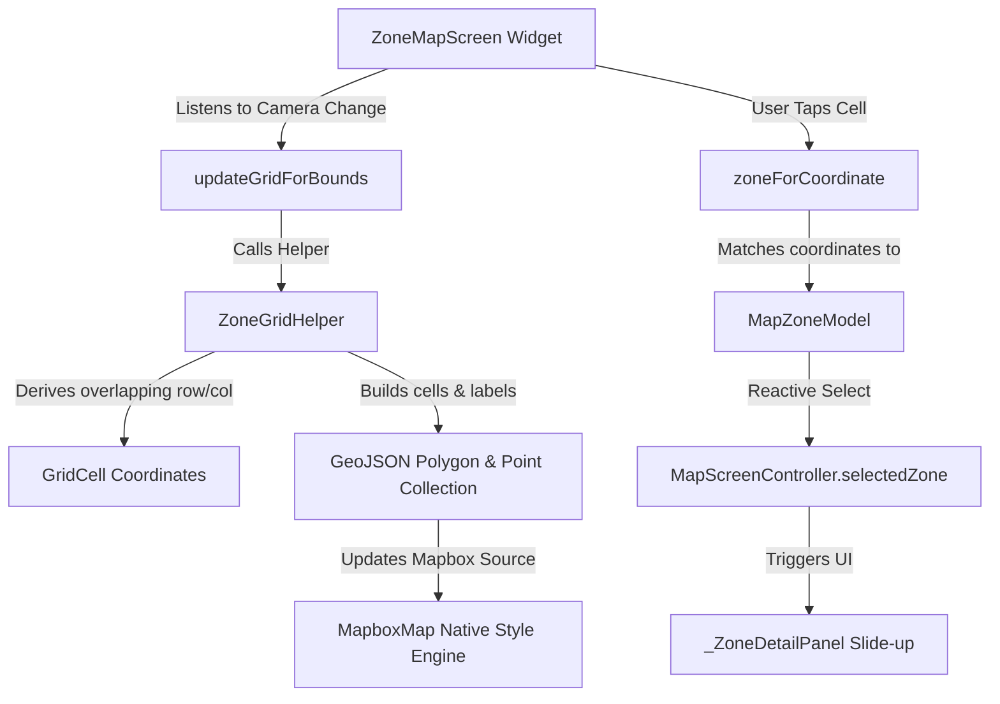
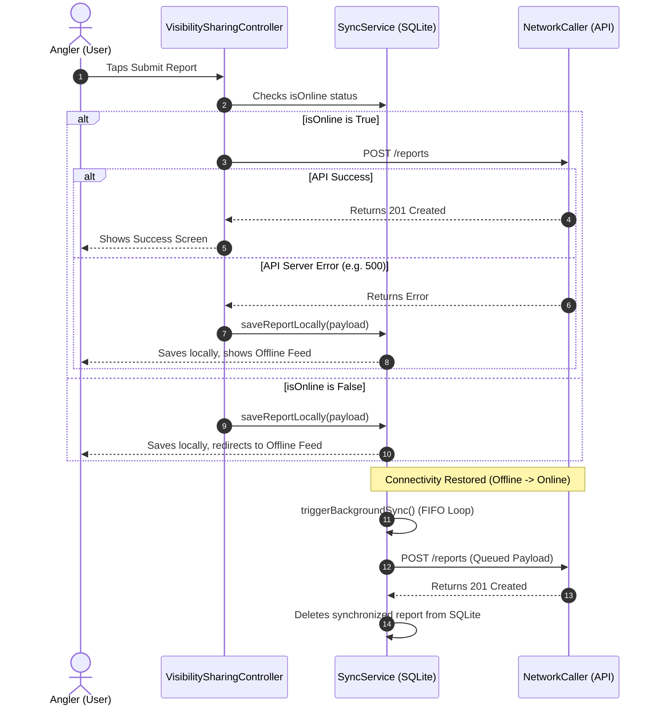

# PaytonPieper Project Analysis & API Tracking Update

This document provides a comprehensive analysis of the **PaytonPieper** project, focusing on the **Map Screen** architecture, geo-anchored grid design, and the status of API integrations across all app features.

---

## Recent Feature Progress & Accomplishments

The project has recently achieved several critical milestones:
- **Hierarchical Species Drill-Down Selector**: Designed a nested tree taxonomy ([SpeciesNode](file:///Users/betopia/kamrul's Project/paytonpieper/lib/core/models/species_node.dart)) and built an interactive bottom-sheet selector ([SpeciesDrillDownBottomSheet](file:///Users/betopia/kamrul's Project/paytonpieper/lib/features/report_main/report_catch2/screen/species_drill_down_bottom_sheet.dart)), enabling clean categories (e.g., Pelagic > Marlin > Blue Marlin) and restricting selection to leaf species.
- **StormGlass API Weather Integration**: Integrated the weather forecast endpoint in [SummaryController](file:///Users/betopia/kamrul's Project/paytonpieper/lib/features/report_main/summary/controller/summary_details_controller.dart), converting metric parameters to imperial values (wind speed, cardinal wind direction mapping, wave height, water temperature, swell direction/period) and rendering them dynamically in [SummaryTabWidget](file:///Users/betopia/kamrul's Project/paytonpieper/lib/features/report_main/summary/widgets/summary_tab_widget.dart).
- **API Optimization & Rate-Limit Protections**: Implemented a 10-second request debounce worker (`_debounceWorker`) in [MapScreenController](file:///Users/betopia/kamrul's Project/paytonpieper/lib/features/map/controller/map_screen_controller.dart) for active zone queries, and a gesture debounce timer (`_gridDebounce`) in [ZoneMapScreen](file:///Users/betopia/kamrul's Project/paytonpieper/lib/features/map/screen/zone_map_screen.dart) to prevent duplicate API requests and unnecessary GeoJSON redraws.
- **Zone Summary API Integration**: Connected [SummaryController](file:///Users/betopia/kamrul's Project/paytonpieper/lib/features/report_main/summary/controller/summary_details_controller.dart) to `/api/v1/zones/summary` to fetch and render zone activity logs, top caught species, hourly timing statistics, and AI-powered pattern intelligence.

---

## 1. Map Screen Architecture & Features Deep Dive

The **Map Screen** (`ZoneMapScreen` / `MapScreenController`) provides interactive, real-time offshore intelligence in the Gulf of Mexico (GOM). It displays fishing activity using a custom data-driven geo-grid layer overlaid on Mapbox satellite imagery.

### 1.1 Grid Specifications & Performance Design (Bulks & Limits)
* **Cell Size**: The grid divides the ocean into individual cells measuring **8.0 × 8.0 statute miles** (`cellMiles: 8.0`).
* **Infinite Geo-Anchoring**: The grid has no pre-defined boundary limit. Coordinates are derived mathematically using an SW origin anchor pinned at Latitude `20.0`, Longitude `-100.0`.
* **Viewport Generation Clamping**: To ensure buttery-smooth map rendering (60 FPS) and avoid overloading the style engine during quick zoom/pan gestures, the grid generator limits the number of cells generated:
  * Overlapping row and column ranges are calculated dynamically from viewport bounds (with a 2-cell buffer).
  * Row and column counts are strictly clamped to a maximum of **60 rows** and **60 columns** each (`rowCount.clamp(0, 60)`).
  * Thus, the engine processes a maximum **safety cap of 3,600 cells** (`60 × 60`) per camera update, keeping rendering fully performant.

### 1.2 Live API Integration vs. Demo Mock Fallback
The grid is **fully functional and integrated with real-time backend API data**, but includes a robust mock fallback system to keep the UI beautiful under all circumstances.

#### Live Production Mode (Active by default)
On screen initialization, `fetchReportsAndPopulateMap()` is triggered:
1. Queries the backend region reports API: `GET /api/v1/zones/reports?regionCode=GOM&scope=region`.
2. Passes the secure local session token `Bearer {accessToken}` via `NetworkCaller`.
3. If successful, the JSON array is grouped dynamically in memory by `zoneId`.
4. The controller computes aggregation metrics on-the-fly for each zone/grid cell:
   * **Average Water Depth**: Extracted and averaged from report `waterDepthFt` values.
   * **Top Target Species**: Scans report species lists, aggregates quantities, and resolves the most frequent species as the "Top Species".
   * **Center Coordinate (Centroid)**: Calculates the average Latitude/Longitude of all reports belonging to that cell to pin its markers.
   * **Activity Level**: Assigns levels reactively:
     * 🟠 **High**: `>= 5` reports.
     * 🔵 **Medium**: `2 - 4` reports.
     * 🔘 **Low**: `1` report.
5. Re-populates the interactive Mapbox fill and label layers instantly.

#### Demo Fallback Mode (Fail-safe)
If the API endpoint is unreachable or returning error status codes (e.g. database offline or no internet connection during setup):
* The app automatically loads local mock data (`loadMockData()`) to prevent rendering empty ocean surfaces.
* Renders **6 pre-configured GOM zones**:
  * `GOM-12`: High activity, 12 reports, top species Tuna, average depth 120 ft.
  * `GOM-8`: High activity, 8 reports, top species Marlin, average depth 95 ft.
  * `GOM-3`: Medium activity, 3 reports, top species Snapper, average depth 60 ft.
  * `GOM-1`: Low activity, 1 report, top species Wahoo, average depth 140 ft.
  * `GOM-7`: Medium activity, 7 reports, top species Mahi, average depth 110 ft.
  * `GOM-4`: Medium activity, 4 reports, top species Sailfish, average depth 200 ft.

---

### Component Map Screen Diagram

### Key Technical Files
1. **[zone_map_screen.dart](file:///Users/betopia/kamrul's Project/paytonpieper/lib/features/map/screen/zone_map_screen.dart)**: Implements Mapbox styling, gesture handlers, camera listener debouncing, location tracking requests, and the details slide panel.
2. **[map_screen_controller.dart](file:///Users/betopia/kamrul's Project/paytonpieper/lib/features/map/controller/map_screen_controller.dart)**: Aggregates list data by `zoneId` dynamically from the backend, maps species frequencies and depths, and feeds GeoJSON updates to the Mapbox style layer.
3. **[zone_grid_helper.dart](file:///Users/betopia/kamrul's Project/paytonpieper/lib/features/map/utils/zone_grid_helper.dart)**: Handles coordinate conversions from miles to lat/long degrees, calculates cell boundaries (SW/NE corners) relative to the grid origin (`20.0, -100.0`), and converts cell data into GeoJSON format.
4. **[map_zone_model.dart](file:///Users/betopia/kamrul's Project/paytonpieper/lib/features/map/model/map_zone_model.dart)**: Stores the schema for zone metrics, including active reports, activity levels, top species, trends, and layout configurations.

---

## 2. Offline-First Synchronization Architecture

To support offshore anglers without cell service, PaytonPieper utilizes an offline-first workflow for report submissions.

---

## 3. Comprehensive API Endpoint Status Tracker

This table details the implementation status of all endpoints defined in `ApiConstants` across the codebase:

| Endpoint Key | API Path | HTTP Method | Associated Controller | Status | Implementation Details |
| :--- | :--- | :---: | :--- | :---: | :--- |
| `createAccountApi` | `/auth/signup` | **POST** | `CreateAccountScreenController` | **COMPLETED** | Submits credentials (`name`, `email`, `password`) to create a pending account. |
| `verifyEmailApi` | `/auth/verify-email` | **POST** | `CreateAccountScreenController` | **COMPLETED** | Verifies OTP code sent to user email to activate the account. |
| `loginApi` | `/auth/login` | **POST** | `LoginController` | **COMPLETED** | Authenticates user; saves access and refresh tokens locally in `StorageService`. |
| `authMeApi` | `/user/me` | **GET** | `ProfileMainScreenController` | **COMPLETED** | Fetches user profile details on app startup or profile refresh. |
| `updateProfileApi` | `/user/profile-update` | **PATCH** | `ProfileMainScreenController` | **COMPLETED** | Multipart form submission to update name (`userName`) and profile photo (`file`). |
| `getAccessTokenApi` | `/auth/refresh-token` | **POST** | `ProfileMainScreenController` | **COMPLETED** | Refreshes expired access token using `userId` and `refreshToken`. |
| `forgotEmailSendApi` | `/auth/forget-password` | **POST** | `ForgotPasswordScreenController` | **COMPLETED** | Sends password reset OTP to the requested email. |
| `verifyForgotPasswordWithOtpApi`| `/auth/reset-password` | **POST** | `ForgotPasswordScreenController` | **COMPLETED** | Resets password using `otp`, `email`, and `newPassword`. |
| `featchGroupListApi` | `/groups` | **GET** | `GroupMainScreenController` | **COMPLETED** | Fetches list of all groups the logged-in user is a member of. |
| `featchSingleGroupDetailsApi` | `/groups/{groupId}` | **GET** | `GroupDetailsScreenController` | **COMPLETED** | Fetches detailed metadata, member list, and active reports for a specific group. |
| `createNewGroupApi` | `/groups` | **POST** | `CreateGroupScreenController` | **COMPLETED** | Creates a group using multipart request (`name`, `description`, optional `photo`). |
| `updateGroupApi` | `/groups/{groupId}` | **PATCH** | `GroupDetailsScreenController` | **COMPLETED** | Updates group metadata and photo using multipart format. |
| `deleteGroupApi` | `/groups/{groupId}` | **DELETE** | `GroupMainScreenController` | **COMPLETED** | Owner-only deletion of a group. |
| `generateGroupInvitationCodeApi`| `/invites/groups/{groupId}`| **POST** | `GroupDetailsScreenController` | **COMPLETED** | Generates sharing codes (`CODE`) or invites specific friends (`USER`). |
| `joinGroupWithCodeApi` | `/invites/join` | **POST** | `GroupMainScreenController` | **COMPLETED** | Joins a group by submitting a valid verification code. |
| `leaveGroupApi` | `/groups/{groupId}/leave` | **POST** | `GroupDetailsScreenController` | **COMPLETED** | Removes the current user from the specified group membership. |
| `featchUserForInviationApi` | `/user/all-user` | **GET** | `GroupDetailsScreenController` | **COMPLETED** | Queries platform users with search parameters and pagination to send invitations. |
| `seeMyInvitationApi` | `/invites/my-pending` | **GET** | `SeeMyInvitationController` | **COMPLETED** | Retrieves incoming group invitations pending approval. |
| `approveInvitationApi` | `/invites/{inviteId}/accept`| **POST** | `SeeMyInvitationController` | **COMPLETED** | Accepts group invitation. |
| `rejectInvitationApi` | `/invites/{inviteId}/decline`| **POST** | `SeeMyInvitationController` | **COMPLETED** | Rejects group invitation. |
| `showAllPendingInvitationOfAGroupApi`| `/invites/groups/{groupId}`| **GET** | `GroupDetailsScreenController` | **COMPLETED** | Fetches pending outgoing group invites sent by owners. |
| `revokeInvitationUserApi` | `/invites/{inviteId}/revoke`| **DELETE**| `GroupDetailsScreenController` | **COMPLETED** | Cancels a pending outgoing invitation before it is accepted. |
| `removeMemberFromGroupByOwnerApi` | `/groups/{groupId}/members/{userId}`| **DELETE**| `GroupDetailsScreenController` | **COMPLETED** | Allows the group owner to remove members from the group. |
| `submitReportApi` | `/reports` | **POST** | `VisibilitySharingController` | **COMPLETED** | Submits a report. If offline, triggers local SQLite cache insertion. |
| `getRegionReportsApi` | `/zones/reports?regionCode=GOM&scope=region`| **GET** | `SummaryController` & `MapScreenController` | **COMPLETED** | Fetches historical reports in the GOM region to populate feeds and map grids. |
| `getZoneSummaryApi` | `/zones/summary` | **GET** | `SummaryController` | **COMPLETED** | Fetches metrics (Top Species, AI summaries, Hit Rate, Hourly Histograms). |
| `confirmReportApi` | `/reports/{reportId}/confirm`| **POST** | `SummaryController` | **COMPLETED** | Submits a bite confirmation request to update a report's confirm count. |
| `rejectReportApi` | `/reports/{reportId}/reject`| **POST** | `SummaryController` | **COMPLETED** | Submits a bite rejection request to decrease/reject a report's confirm count. |

---

## 4. Key Subsystem Details

### 4.1 Weather Integration (External API)
* **Endpoint**: `GET https://api.stormglass.io/v2/weather/point?lat={lat}&lng={lng}&params=windSpeed,windDirection,waveHeight,waterTemperature,airTemperature,cloudCover`
* **Controller**: `SummaryController`
* **Features**:
  * **Real-time Weather**: Converts values from metric to standard imperial (m/s to mph, meters to feet, Celsius to Fahrenheit).
  * **Wind Direction Cardinal Mapping**: Maps angular degrees into standard compass abbreviations (e.g. `NE`, `SW`).
  * **5-Day Forecast Intervals**: Generates tab controls and displays detailed weather periods for `Morning`, `Afternoon`, and `Evening`.

### 4.2 Offline Storage (SQLite Schema)
The offline repository uses a single SQLite table database `offline_sync.db` to log failed or offline catch reports.
* **Table Name**: `pending_reports`
* **Schema**:
  * `id`: `INTEGER PRIMARY KEY AUTOINCREMENT`
  * `frontendReportId`: `TEXT UNIQUE` (Client-side UUID v4 prevents duplicates during synchronization retries)
  * `payload`: `TEXT` (JSON serialized report body)
  * `createdAt`: `TEXT` (Timestamp)
  * `queueStatus`: `TEXT` (Status, defaults to `PENDING`)

### 4.3 Hierarchical Species Selector
To prevent cluttered, flat species lists and structured reporting errors, a custom hierarchical taxonomy is modeled.
* **Model Class**: [SpeciesNode](file:///Users/betopia/kamrul's Project/paytonpieper/lib/core/models/species_node.dart) (stores `name`, `isSelectable`, and child list `children`)
* **Hierarchical Tree**: Starts from broad groups (e.g. `Pelagic`) and drills down through intermediate categories (e.g. `Tuna`, `Marlin`) into leaf nodes (`Yellowfin Tuna`, `Blue Marlin`).
* **UX Implementation**: [SpeciesDrillDownBottomSheet](file:///Users/betopia/kamrul's Project/paytonpieper/lib/features/report_main/report_catch2/screen/species_drill_down_bottom_sheet.dart) manages an internal navigation path stack (`_nodeHistory`), rendering lists dynamically. Sub-directories display a chevron icon (`>`), while selectable leaf nodes display an orange add-circle icon.
* **Selectability Rules**: Anglers can only choose valid leaf nodes (`isSelectable: true`), preventing incorrect submissions of general categories like "Tuna" or "Billfish".

---

## 5. Incomplete Features & Future Enhancements

Although the core API integrations and workflows are fully operational, several components currently utilize fallback stubs or mock mechanisms:

### 5.1 Dynamic Sharing Group Fetching
* **Subsystem**: Submission Sharing Dialog
* **Controller**: [VisibilitySharingController](file:///Users/betopia/kamrul's Project/paytonpieper/lib/features/submit_report/controller/submit_report_controller.dart)
* **Current Status**: Uses a static mock array `privateGroups` to present selection targets (e.g., "Miami Offshore Crew", "Keys Anglers").
* **Requirement**: Integrate a dynamic GET call to `ApiConstants.featchGroupListApi` inside the controller to fetch and display the user's actual group memberships.

### 5.2 Offline Report Feed Static Merging
* **Subsystem**: Offline Reports Feed
* **Controller**: [OfflineReportsTabController](file:///Users/betopia/kamrul's Project/paytonpieper/lib/features/report_main/offline_report/controller/offline_report_controller.dart)
* **Current Status**: Merges pending offline reports stored in SQLite with three static mock reports in `loadReports()` to populate the UI list.
* **Requirement**: Transition the list logic to fetch and display actual user-submitted records from the server once online, or restrict the offline screen purely to local SQLite pending items.

### 5.3 Weather API Error/Missing Slot Fallbacks
* **Subsystem**: Summary Details Weather Tab
* **Widget**: [WeatherTabWidget](file:///Users/betopia/kamrul's Project/paytonpieper/lib/features/report_main/summary/widgets/weather_tab_widget.dart)
* **Current Status**: Falls back to static forecast slots (`_mockForecastDataFor`) if the StormGlass API response does not populate specific hourly forecast entries for the requested day.
* **Requirement**: Design a more robust interpolation routine to fill missing values using neighboring hourly slots or utilize a secondary weather provider API (e.g., OpenWeatherMap) as a hot fallback.

### 5.4 Report Details Dynamic Deep-Linking
* **Subsystem**: Report Detail View
* **Screen**: [ReportDetailsScreen](file:///Users/betopia/kamrul's Project/paytonpieper/lib/features/success_submit_report/screen/report_details_screen.dart)
* **Current Status**: Reads arguments passed during screen navigation; if arguments are absent, it populates widgets with hardcoded mockup parameters.
* **Requirement**: Implement a dynamic lookup endpoint (e.g., `GET /reports/{reportId}`) to fetch complete report metadata directly from the server when deep-linking.

