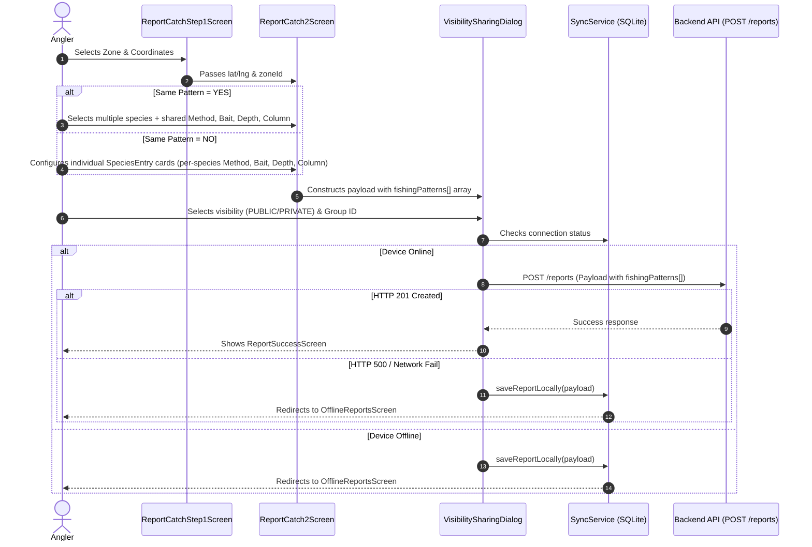

# PaytonPieper Project — Complete Analysis, API Tracking & Endpoint Specifications

> **Last Updated**: 2026-07-31  
> **Analyzer**: AI Deep Scan — Full Codebase & Architecture Audit  
> **Base URL**: `https://onthebitefishing.com/api/v1` (fallback dev: `http://172.252.13.68:8000/api/v1`)  
> **Socket URL**: `https://onthebitefishing.com` (derived by stripping `/api/v1`)

---

## Executive Summary: How the PaytonPieper App Works (Plain English Guide)

> **What is PaytonPieper ("On The Bite")?**  
> PaytonPieper is a specialized offshore marine fishing intelligence and community platform built for anglers navigating the Gulf of Mexico. It turns raw fishing logs and satellite marine weather into real-time heatmaps, bite forecasts, and private group intelligence.

```
       ┌─────────────────────────────────────────────────────────────┐
       │                    PAYTONPIEPER APP ENGINE                   │
       └──────────────────────────────┬──────────────────────────────┘
                                      │
  ┌───────────────────────┬───────────┴───────────┬───────────────────────┐
  │                       │                       │                       │
  ▼                       ▼                       ▼                       ▼
┌──────────────┐   ┌──────────────┐   ┌──────────────┐   ┌──────────────┐
│ 1. GRID MAP  │   │ 2. CATCH LOG │   │ 3. OFFLINE   │   │ 4. COMMUNITY │
│ & HEATMAPS   │   │ & PATTERNS   │   │ ENGINE       │   │ & REALTIME   │
└──────┬───────┘   └──────┬───────┘   └──────┬───────┘   └──────┬───────┘
       │                  │                  │                  │
       ▼                  ▼                  ▼                  ▼
• 8×8 mi Grid      • 3-Step Wizard    • SQLite DB        • WebSocket Chat
• Activity Scores  • Multi-Species    • 100-Yr Cache     • Private Groups
• Mapbox Satellite • Method/Bait Rules• Auto-Sync        • FCM Push Alerts
```

---

### The 5 Core Pillars of the App

#### 1. Heatmap Grid System (Map & Zones)
- **The Concept**: The Gulf of Mexico is mathematically partitioned into an 8.0 × 8.0 statute mile grid (formatted as `GOM-R{row}-C{col}`, e.g. `GOM-R74-C88`).
- **How it Works**: As the user pans the map on [ZoneMapScreen](file:///Users/betopia/kamrul_Project/paytonpieper/lib/features/map/screen/zone_map_screen.dart), [MapScreenController](file:///Users/betopia/kamrul_Project/paytonpieper/lib/features/map/controller/map_screen_controller.dart) fetches active grid cells via `GET /zones`. Cells are color-coded in real-time:
  - 🟠 **High Activity (Orange)**: 5+ catch reports or score ≥ 70
  - 🔵 **Medium Activity (Cyan)**: 1+ catch report or score ≥ 30
  - 🔘 **Low Activity (Dark)**: Background baseline
- **Interactive Panel**: Tapping any cell opens `_ZoneDetailPanel`, which queries `GET /zones/summary` to show live activity scores, trend direction (Rising/Falling), top species, average water depth, and peak fishing windows.

#### 2. Catch Logging & Pattern Intelligence (`fishingPatterns`)
- **The Concept**: Anglers log what they catch, where, at what depth, and using which bait/method.
- **How it Works**: A 3-step workflow guided by [ReportCatchController](file:///Users/betopia/kamrul_Project/paytonpieper/lib/features/report_main/report_catch/controller/report_catch_step1_screen.dart), [ReportCatch2Controller](file:///Users/betopia/kamrul_Project/paytonpieper/lib/features/report_main/report_catch2/controller/report_catch2_controller.dart), and [VisibilitySharingController](file:///Users/betopia/kamrul_Project/paytonpieper/lib/features/submit_report/controller/submit_report_controller.dart):
  - **Step 1**: Select location & grid cell on map.
  - **Step 2**: Choose species & pattern:
    - If *Same Pattern*: Multiple fish share one method (e.g. Trolling with Skirted Lures at 150ft).
    - If *Different Pattern*: Each species card has its own custom method, bait, and depth.
    - *Method-Bait Dependency*: Selecting "Trolling" only unlocks trolling lures (Diving, Skirted, Plug); selecting "Jigging" unlocks Vertical/Slow jigs.
  - **Step 3**: Choose visibility (`PUBLIC` vs `PRIVATE`) and optionally share with a private Group.

#### 3. Offline-First System (Works Far Out at Sea)
- **The Problem**: Anglers lose cellular service 15+ miles offshore.
- **The Solution**: 
  - **Offline Report Queue**: When offline, [SyncService](file:///Users/betopia/kamrul_Project/paytonpieper/lib/core/services/sync_service.dart) saves catch logs locally into an SQLite database (`offline_sync.db`). As soon as the device reconnects to internet/cellular, `SyncService` automatically uploads queued reports in the background.
  - **Offline Map & Intelligence Cache**: Users can tap "Save Offline" on any grid cell to store 100-year cached weather and AI summaries (`offline_cache.db`), and download Mapbox satellite map tiles via [MapboxOfflineService](file:///Users/betopia/kamrul_Project/paytonpieper/lib/core/services/mapbox_offline_service.dart).

#### 4. Weather Forecasts & Background Weather Watcher
- **Marine Weather**: Integrates StormGlass.io API to fetch wave height, wind speed/direction, water temperature, air temperature, cloud cover, and precipitation for any GPS point. Converts metric data into marine imperial units (mph, feet, °F).
- **Background Alert Engine**: [WeatherAlertService](file:///Users/betopia/kamrul_Project/paytonpieper/lib/core/services/weather_alert_service.dart) continuously monitors watched zones in the background every 30 minutes. If wave heights spike above user thresholds (e.g., ≥ 4.0 ft) or thunderstorms develop, it displays an in-app alert snackbar with a direct "View Zone" button.

#### 5. Private Groups, Real-Time Chat & FCM Push Notifications
- **Private Groups**: Anglers create fishing clubs, invite friends via codes/emails, and share exclusive catch reports that non-members cannot see.
- **Real-Time Group Chat**: Driven by `socket_io_client` WebSocket connection to `https://onthebitefishing.com`. Supports live messaging, reply threading, typing indicators, online user lists, and message deletion.
- **Push Notifications**: Integrated with Firebase Cloud Messaging (FCM) to trigger background/foreground alerts for weather warnings, bite activity spikes, and group intel shares.

---

### Code Base Architecture Guide (For Developers)

The app follows the **GetX Model-View-Controller (MVC)** architectural pattern:

```
                  ┌─────────────────────────────────┐
                  │          USER INTERFACE         │
                  │   Screens & Widgets (Views)     │
                  └────────────────┬────────────────┘
                                   │ (Events / Reactive Bindings)
                                   ▼
                  ┌─────────────────────────────────┐
                  │       BUSINESS LOGIC LAYER      │
                  │   GetX Controllers (.obs state) │
                  └────────────────┬────────────────┘
                                   │ (HTTP / Socket Calls)
                                   ▼
                  ┌─────────────────────────────────┐
                  │        DATA & SERVICE LAYER     │
                  │ NetworkCaller, SyncService, DBs │
                  └─────────────────────────────────┘
```

- **`lib/core/services/`**: The core engines (Networking, Storage, SQLite Caching, Weather Alerts, Map Downloads, FCM).
- **`lib/features/`**: Divided into isolated feature modules (e.g. `authentication`, `groups`, `map`, `report_main`, `weather_alerts`). Each feature contains its own:
  - `controller/`: Holds reactive GetX state (`RxBool`, `RxList`, `obs`), handles API calls.
  - `screen/` or `presentation/`: Pure Flutter UI widgets.
  - `model/`: Data structure classes (`GroupDetailModel`, `FishingReport`, `WatchedZoneConfig`).
- **`lib/routes/app_routes.dart`**: Central navigation registry defining all screen routes and GetX lazy bindings.
- **`lib/core/bindings/controller_binder.dart`**: Global dependency injection container registered at app launch.

---

## Table of Contents

1. [Project Architecture Overview](#1-project-architecture-overview)
2. [Core Services Layer](#2-core-services-layer)
3. [Authentication Flow](#3-authentication-flow)
4. [Profile & Settings Flow](#4-profile--settings-flow)
5. [Group Management Flow](#5-group-management-flow)
6. [Group Invitation Flow](#6-group-invitation-flow)
7. [Group Chat (WebSocket) Flow](#7-group-chat-websocket-flow)
8. [Report Submission Flow (`fishingPatterns` Migration)](#8-report-submission-flow-fishingpatterns-migration)
9. [Offline Sync & Caching Architecture](#9-offline-sync--caching-architecture)
10. [Map Screen & Zone Flow](#10-map-screen--zone-flow)
11. [Summary & Intelligence Flow](#11-summary--intelligence-flow)
12. [Weather Integration Flow (StormGlass.io)](#12-weather-integration-flow-stormglassio)
13. [Bite Confirmation Flow](#13-bite-confirmation-flow)
14. [Weather Alerts & Bite Watch Flow](#14-weather-alerts--bite-watch-flow)
15. [Notification & FCM Push System](#15-notification--fcm-push-system)
16. [Payment & Subscription Flow](#16-payment--subscription-flow)
17. [Navigation & Routing Architecture](#17-navigation--routing-architecture)
18. [Exhaustive API Endpoint & Response Specifications](#18-exhaustive-api-endpoint--response-specifications)
    - 18.1 Authentication Endpoints (7)
    - 18.2 User Profile & Account Endpoints (5)
    - 18.3 Group Management Endpoints (7)
    - 18.4 Group Invitation Endpoints (8)
    - 18.5 Catch Reports Endpoints (5)
    - 18.6 Map, Heatmap & Zone Intelligence Endpoints (5)
    - 18.7 Notification Settings & FCM Endpoints (4)
    - 18.8 Subscription & Payment Endpoints (2)
    - 18.9 External Weather & Real-Time Chat Endpoints (2)
19. [Incomplete Features & Future Enhancements](#19-incomplete-features--future-enhancements)
20. [Architecture Diagrams](#20-architecture-diagrams)
21. [Session Progress Log & Revision History](#21-session-progress-log--revision-history)

---

## 1. Project Architecture Overview

**Framework**: Flutter (Dart) with **GetX** for state management, dependency injection, and routing.

### Directory Structure

```
lib/
├── main.dart                           # App entry point — StorageService.init(), Firebase.initializeApp(), runApp()
├── app.dart                            # GetMaterialApp wrapper — theme, routes, bindings (ControllerBinder)
├── firebase_options.dart               # Firebase config (auto-generated)
├── core/
│   ├── bindings/controller_binder.dart # Global GetX controller & service registration
│   ├── common/
│   │   ├── styles/                     # Global text styles
│   │   └── widgets/                    # Shared widgets (CommonMessage, CustomButton, CustomBackButton, etc.)
│   ├── models/
│   │   ├── response_data.dart          # ResponseData model (isSuccess, statusCode, responseData, errorMessage)
│   │   └── species_node.dart           # Hierarchical species taxonomy model
│   ├── services/
│   │   ├── network_caller.dart         # HTTP client with caching, timeout, and logging
│   │   ├── storage_service.dart        # SharedPreferences wrapper (tokens, userId, watched zones, alert cache)
│   │   ├── sync_service.dart           # Offline SQLite queue + background sync + TCP check
│   │   ├── offline_cache_service.dart  # Thread-safe SQLite API cache with configurable TTL
│   │   ├── mapbox_offline_service.dart # Mapbox satellite offline style & tile downloader
│   │   ├── weather_alert_service.dart  # StormGlass background watcher, suppression & GetX snackbar alerts
│   │   ├── firebase/                   # Firebase Push Notification services
│   │   │   ├── app_notification_initializer.dart # FCM foreground & background handler setup
│   │   │   ├── fcm_handler.dart        # Routing FCM payloads to snackbars & screens
│   │   │   ├── firebase_service.dart   # Core Firebase app initialization wrapper
│   │   │   └── notification_service.dart # Device token retrieval & channel setup
│   │   └── permissions/                # Location permission handler
│   ├── utils/
│   │   ├── constants/
│   │   │   ├── api_constants.dart      # All API endpoint URLs & keys
│   │   │   ├── colors.dart             # App color palette
│   │   │   ├── enums.dart              # Global enums
│   │   │   ├── icon_path.dart          # SVG/PNG icon paths
│   │   │   ├── image_path.dart         # Image asset paths
│   │   │   └── sizer.dart              # Responsive sizing
│   │   ├── device/                     # Device utilities
│   │   ├── formatters/                 # Input formatters
│   │   ├── helpers/                    # Helper functions
│   │   ├── logging/logger.dart         # AppLoggerHelper (info/warning/error)
│   │   ├── mapbox_config.dart          # Mapbox access token
│   │   ├── theme/                      # App theming
│   │   └── validators/                 # Input validation
│   ├── localization/                   # Internationalization files
│   └── datetime_formate                # Date/Time formatting
├── features/
│   ├── authentication/                 # Login, Register, Email OTP, Forgot Password, Google/Apple login
│   ├── groups/                         # Group CRUD, Invitations, Chat (WebSocket), Members, Group Reports
│   ├── main_screen/                    # Bottom nav host (Map, Reports, Groups, Profile tabs) + FilterController
│   ├── map/                            # Mapbox satellite heatmap with 8×8mi grid + _ZoneDetailPanel
│   ├── notification/                   # Notification center UI
│   ├── onboarding/                     # 4-screen onboarding flow
│   ├── payment_service/                # Stripe subscription payment sheet
│   ├── profile_and_setting/            # Profile CRUD, Settings, Map offline download, Subscription plans
│   ├── report_main/                    # Reports feed, Summary intelligence, Weather forecast, Offline reports
│   │   ├── offline_report/             # SQLite pending reports tab
│   │   ├── report_catch/               # Step 1: Location & Zone selection
│   │   ├── report_catch2/              # Step 2: Species, Quantity, fishingPatterns, Method-Bait rules
│   │   └── summary/                    # AI Summary & Weather tab
│   ├── splash_screen/                  # App splash with auth check
│   ├── submit_report/                  # Step 3: Visibility/group sharing + payload construction
│   ├── success_submit_report/          # Post-submission success + report detail view
│   └── weather_alerts/                 # Watched zones manager, threshold settings sheets & Bite Watch UI
├── routes/app_routes.dart              # Named route registry (23+ routes)
└── utils/zone_calculator.dart          # Mathematical zone ID ↔ lat/lng grid converter
```

---

## 2. Core Services Layer

### 2.1 NetworkCaller — [network_caller.dart](file:///Users/betopia/kamrul_Project/paytonpieper/lib/core/services/network_caller.dart)

Central HTTP client with token injection, logging, error normalization, and caching support:

| Method | Function | Content-Type | Caching Support |
|:---|:---|:---|:---|
| **GET** | `getRequest(url, token?)` | `application/json` | Standard network call |
| **Cached GET** | `cachedGetRequest(url, cacheKey, ttlMinutes, forceRefresh)` | `application/json` | Evaluates SQLite cache first, falls back on offline |
| **POST** | `postRequest(url, body?, token?)` | `application/json` | Direct network call |
| **PATCH** | `patchRequest(url, body?, token?)` | `application/json` | Direct network call |
| **DELETE** | `deleteRequest(url, token?)` | `application/json` | Direct network call |
| **POST Multipart** | `postMultipartRequest(url, fields?, file?, token?)` | `multipart/form-data` | Multipart upload |
| **PATCH Multipart** | `patchMultipartRequest(url, fields?, file?, token?)` | `multipart/form-data` | Multipart update |

---

## 3. Authentication Flow

### 3.1 Create Account & Email Verification

**Controller**: [CreateAccountScreenController](file:///Users/betopia/kamrul_Project/paytonpieper/lib/features/authentication/controllers/create_account_screen_controller.dart)

```
[CreateAccountScreen] ──(POST /auth/signup)──> [VerifyEmailOtpScreen] ──(POST /auth/verify-email)──> [LoginScreen]
```

1. **Signup**: `POST /auth/signup` with `{"name": "...", "email": "...", "password": "..."}`
2. **Email OTP**: `POST /auth/verify-email` with `{"email": "...", "otp": "..."}`
3. **On Success**: Redirects user to `LoginScreen`.

---

## 4. Profile & Settings Flow

**Controller**: [ProfileMainScreenController](file:///Users/betopia/kamrul_Project/paytonpieper/lib/features/profile_and_setting/controller/profile_main_screen_controller.dart) & [SettingsScreenController](file:///Users/betopia/kamrul_Project/paytonpieper/lib/features/profile_and_setting/controller/settings_screen_controller.dart)

- **Fetch Profile**: `GET /user/me` (populates `AuthMeModel`, saves `userId`). Auto-retries via token refresh on 401.
- **Refresh Token**: `POST /auth/refresh-token` with `{"userId": "...", "refreshToken": "..."}`.
- **Update Profile**: `PATCH /user/profile-update` (`multipart/form-data` with `userName` and optional `file`).
- **Offline Map Region Download**: Controlled via `SettingsScreenController.downloadMapArea()`, managed by `MapboxOfflineService`.
- **Logout**: Clears SharedPreferences via `StorageService.logoutUser()` and redirects to `LoginScreen`.

---

## 5. Group Management Flow

**Controllers**: [GroupMainScreenController](file:///Users/betopia/kamrul_Project/paytonpieper/lib/features/groups/controller/group_main_screen_controller.dart), [GroupDetailsScreenController](file:///Users/betopia/kamrul_Project/paytonpieper/lib/features/groups/controller/group_details_screen_controller.dart), [CreateGroupScreenController](file:///Users/betopia/kamrul_Project/paytonpieper/lib/features/groups/controller/create_group_screen_controller.dart)

| Action | Endpoint | Method | Format | Notes |
|:---|:---|:---:|:---|:---|
| Fetch Groups | `/groups` | **GET** | JSON | Returns user's group list |
| Group Details | `/groups/{groupId}` | **GET** | JSON | Details + member roster |
| Create Group | `/groups` | **POST** | Multipart | `name`, `description`, `isPrivate`, `photo` |
| Update Group | `/groups/{groupId}` | **PATCH** | Multipart | `name`, `description`, `isPrivate`, `photo` |
| Delete Group | `/groups/{groupId}` | **DELETE** | JSON | Owner only |
| Leave Group | `/groups/{groupId}/leave` | **POST** | JSON | Exits user from group |
| Remove Member | `/groups/{groupId}/members/{userId}` | **DELETE** | JSON | Owner removes member |
| Group Reports | `/reports?groupId={groupId}&page=1&limit=20` | **GET** | JSON | Reports shared with group |

---

## 6. Group Invitation Flow

**Controllers**: [GroupDetailsScreenController](file:///Users/betopia/kamrul_Project/paytonpieper/lib/features/groups/controller/group_details_screen_controller.dart), [SeeMyInvitationController](file:///Users/betopia/kamrul_Project/paytonpieper/lib/features/groups/controller/see_my_invitation_controller.dart), [GroupMainScreenController](file:///Users/betopia/kamrul_Project/paytonpieper/lib/features/groups/controller/group_main_screen_controller.dart)

- **Invite Friends by ID**: `POST /invites/groups/{groupId}` with `{"type": "USER", "inviteeUserIds": ["uuid1", "uuid2"]}`.
- **Generate Invite Code**: `POST /invites/groups/{groupId}` with `{"type": "CODE"}` → returns `inviteCode`.
- **Invite by Email**: `POST /invites/groups/{groupId}` with `{"type": "EMAIL", "inviteeEmail": "..."}`.
- **Join by Code**: `POST /invites/join` with `{"inviteCode": "..."}`.
- **My Pending Invitations**: `GET /invites/my-pending`. Accept via `POST /invites/{id}/accept`, decline via `POST /invites/{id}/decline`.
- **Group Pending Invites (Owner View)**: `GET /invites/groups/{groupId}`. Revoke via `DELETE /invites/{id}/revoke`.
- **Search Invitable Users**: `GET /user/all-user?search={q}&page={p}&limit=10&groupId={id}`.

---

## 7. Group Chat (WebSocket) Flow

**Controller**: [MessageServiceController](file:///Users/betopia/kamrul_Project/paytonpieper/lib/features/groups/controller/message_service_controller.dart)

- **Engine**: `socket_io_client` connected to `https://onthebitefishing.com`. Transports: `['websocket']`.
- **Auth**: Token passed in header `Authorization: Bearer {token}` and socket query params.
- **Client Emitted Events**: `getMessages`, `sendMessage`, `deleteMessage`, `getOnlineUsers`, `typing`.
- **Server Received Events**: `newMessage`, `userTyping`, `messageDeleted`.

---

## 8. Report Submission Flow (`fishingPatterns` Migration)

**Controllers**: [ReportCatchController](file:///Users/betopia/kamrul_Project/paytonpieper/lib/features/report_main/report_catch/controller/report_catch_step1_screen.dart), [ReportCatch2Controller](file:///Users/betopia/kamrul_Project/paytonpieper/lib/features/report_main/report_catch2/controller/report_catch2_controller.dart), [VisibilitySharingController](file:///Users/betopia/kamrul_Project/paytonpieper/lib/features/submit_report/controller/submit_report_controller.dart)

### 8.1 Method ↔ Bait Dependency Rules

Bait options filter dynamically based on the selected method:
- **Trolling**: `Diving Lure`, `Cut Bait`, `Live Bait`, `Plug Lure`, `Skirted Lure`, `Other`.
- **Casting**: `Cut Bait`, `Live Bait`, `Popper`, `Soft Plastic`, `Stickbait`, `Other`.
- **Jigging**: `Slow Jig`, `Vertical Jig`, `Other`.
- **Chunking**: `Cut Bait`, `Other`.
- **Anchor / Spot Fishing**: `Cut Bait`, `Live Bait`, `Other`.
- **Spearing / Other**: `Other`.

---

## 9. Offline Sync & Caching Architecture

1. **SQLite Database 1 (`offline_sync.db`)**: Table `pending_reports` stores queued report JSON payloads when network is unavailable.
2. **SQLite Database 2 (`offline_cache.db`)**: Table `cached_responses` stores API GET payloads keyed by URL/parameters with configurable TTL.
3. **100-Year Offline Zone Caching**: Persists summary & weather data with a TTL of `52,560,000` minutes (100 years).

---

## 10. Map Screen & Zone Flow

**Controller**: [MapScreenController](file:///Users/betopia/kamrul_Project/paytonpieper/lib/features/map/controller/map_screen_controller.dart) & `_ZoneDetailPanel`

- **Grid Math**: 8.0 × 8.0 mile grid over the Gulf of Mexico originating at `(20.0°N, -100.0°W)`. Format: `GOM-R{row}-C{col}`.
- **Viewport Fetching**: `GET /zones?south={s}&north={n}&west={w}&east={e}&...filters`.

---

## 11. Summary & Intelligence Flow

**Controller**: [SummaryController](file:///Users/betopia/kamrul_Project/paytonpieper/lib/features/report_main/summary/controller/summary_details_controller.dart)

- **Region Reports**: `GET /zones/reports?regionCode=GOM&scope=region`.
- **AI Summary Intelligence**: `GET /zones/summary`.

---

## 12. Weather Integration Flow (StormGlass.io)

- **API Endpoint**: `GET https://api.stormglass.io/v2/weather/point?lat={lat}&lng={lng}&params=windSpeed,windDirection,waveHeight,waterTemperature,airTemperature,cloudCover,swellDirection,swellPeriod`

---

## 13. Bite Confirmation Flow

- **Confirm Bite**: `POST /reports/{reportId}/confirm`
- **Reject Bite**: `POST /reports/{reportId}/reject`

---

## 14. Weather Alerts & Bite Watch Flow

**Services & Controllers**: [WeatherAlertService](file:///Users/betopia/kamrul_Project/paytonpieper/lib/core/services/weather_alert_service.dart), [WeatherAlertController](file:///Users/betopia/kamrul_Project/paytonpieper/lib/features/weather_alerts/controller/weather_alert_controller.dart), [BiteWatchController](file:///Users/betopia/kamrul_Project/paytonpieper/lib/features/weather_alerts/controller/bite_watch_controller.dart)

---

## 15. Notification & FCM Push System

**Services Layer**: `AppNotificationInitializer`, `FCMHandler`, `NotificationService`, `FirebaseService`

---

## 16. Payment & Subscription Flow

**Controller**: [PaymentServiceController](file:///Users/betopia/kamrul_Project/paytonpieper/lib/features/payment_service/controller/payment_service_controller.dart)

- **Fetch Plans**: `GET /subscriptions/plans`
- **Payment Intent**: `POST /subscriptions/intent`

---

## 17. Navigation & Routing Architecture

Registered routes in [app_routes.dart](file:///Users/betopia/kamrul_Project/paytonpieper/lib/routes/app_routes.dart): 23+ named routes.

---

## 18. Exhaustive API Endpoint & Response Specifications

This section documents **EVERY API ENDPOINT** in the system with exact URL parameters, required headers, request payloads, and success/error JSON response shapes.

---

### 18.1 Authentication Endpoints (7 Endpoints)

#### 1. Signup / Register
- **Endpoint Key**: `createAccountApi`
- **Path**: `POST /auth/signup`
- **Headers**: `Content-Type: application/json`
- **Request Body**:
  ```json
  {
    "name": "John Doe",
    "email": "johndoe@example.com",
    "password": "Password123!"
  }
  ```
- **Success Response (201 Created)**:
  ```json
  {
    "statusCode": 201,
    "isSuccess": true,
    "message": "Registration successful. Please check your email for the verification code.",
    "responseData": {
      "email": "johndoe@example.com"
    }
  }
  ```
- **Error Response (400 Bad Request)**:
  ```json
  {
    "statusCode": 400,
    "isSuccess": false,
    "message": "Validation failed",
    "errorSources": [
      { "path": "email", "message": "Email already registered." }
    ]
  }
  ```

---

#### 2. Verify Email OTP
- **Endpoint Key**: `verifyEmailApi`
- **Path**: `POST /auth/verify-email`
- **Headers**: `Content-Type: application/json`
- **Request Body**:
  ```json
  {
    "email": "johndoe@example.com",
    "otp": "123456"
  }
  ```
- **Success Response (200 OK)**:
  ```json
  {
    "statusCode": 200,
    "isSuccess": true,
    "message": "Email verified successfully."
  }
  ```

---

#### 3. Login with Email & Password
- **Endpoint Key**: `loginApi`
- **Path**: `POST /auth/login`
- **Headers**: `Content-Type: application/json`
- **Request Body**:
  ```json
  {
    "email": "johndoe@example.com",
    "password": "Password123!"
  }
  ```
- **Success Response (200 OK)**:
  ```json
  {
    "statusCode": 200,
    "isSuccess": true,
    "responseData": {
      "data": {
        "accessToken": "eyJhbGciOiJIUzI1NiIsInR5cCI6IkpXVCJ9...",
        "refreshToken": "d7a89bc2-45e1-88ef-23ab-892341234567"
      }
    }
  }
  ```
- **Error Response (401 Unauthorized)**:
  ```json
  {
    "statusCode": 401,
    "isSuccess": false,
    "message": "Invalid email or password."
  }
  ```

---

#### 4. Social Login (Google / Apple)
- **Endpoint Key**: `socialLoginApi`
- **Path**: `POST /auth/social-login`
- **Headers**: `Content-Type: application/json`
- **Request Body**:
  ```json
  {
    "provider": "GOOGLE",
    "idToken": "eyJhbGciOiJSUzI1NiIs..."
  }
  ```
- **Success Response (200 OK)**:
  ```json
  {
    "statusCode": 200,
    "isSuccess": true,
    "responseData": {
      "data": {
        "accessToken": "jwt_token_here",
        "refreshToken": "refresh_token_here"
      }
    }
  }
  ```

---

#### 5. Refresh Access Token
- **Endpoint Key**: `getAccessTokenApi`
- **Path**: `POST /auth/refresh-token`
- **Headers**: `Content-Type: application/json`
- **Request Body**:
  ```json
  {
    "userId": "a1b2c3d4-e5f6-7a8b-9c0d-1e2f3a4b5c6d",
    "refreshToken": "d7a89bc2-45e1-88ef-23ab-892341234567"
  }
  ```
- **Success Response (200 OK)**:
  ```json
  {
    "statusCode": 200,
    "isSuccess": true,
    "responseData": {
      "data": {
        "accessToken": "new_jwt_access_token",
        "refreshToken": "new_jwt_refresh_token"
      }
    }
  }
  ```

---

#### 6. Forgot Password (Send OTP)
- **Endpoint Key**: `forgotEmailSendApi`
- **Path**: `POST /auth/forget-password`
- **Headers**: `Content-Type: application/json`
- **Request Body**:
  ```json
  {
    "email": "johndoe@example.com"
  }
  ```
- **Success Response (200 OK)**:
  ```json
  {
    "statusCode": 200,
    "isSuccess": true,
    "message": "OTP has been sent to your email address."
  }
  ```

---

#### 7. Reset Password with OTP
- **Endpoint Key**: `verifyForgotPasswordWithOtpApi`
- **Path**: `POST /auth/reset-password`
- **Headers**: `Content-Type: application/json`
- **Request Body**:
  ```json
  {
    "email": "johndoe@example.com",
    "otp": "654321",
    "newPassword": "NewPassword123!"
  }
  ```
- **Success Response (200 OK)**:
  ```json
  {
    "statusCode": 200,
    "isSuccess": true,
    "message": "Password reset successfully. You can now login."
  }
  ```

---

### 18.2 User Profile & Account Endpoints (5 Endpoints)

#### 8. Fetch Current User Profile (Auth Me)
- **Endpoint Key**: `authMeApi`
- **Path**: `GET /user/me`
- **Headers**: `Authorization: Bearer {accessToken}`
- **Success Response (200 OK)**:
  ```json
  {
    "statusCode": 200,
    "isSuccess": true,
    "responseData": {
      "data": {
        "userId": "a1b2c3d4-e5f6-7a8b-9c0d-1e2f3a4b5c6d",
        "name": "John Doe",
        "email": "johndoe@example.com",
        "profileImage": "https://onthebitefishing.com/uploads/profiles/john.jpg",
        "createdAt": "2026-01-15T08:30:00Z",
        "subscription": {
          "plan": "PRO",
          "status": "ACTIVE",
          "expiresAt": "2027-01-15T08:30:00Z"
        }
      }
    }
  }
  ```

---

#### 9. Update User Profile
- **Endpoint Key**: `updateProfileApi`
- **Path**: `PATCH /user/profile-update`
- **Headers**: `Authorization: Bearer {accessToken}`, `Content-Type: multipart/form-data`
- **Form Fields**: `userName: "John Updated"`
- **File Field**: `file: [binary image]` (optional)
- **Success Response (200 OK)**:
  ```json
  {
    "statusCode": 200,
    "isSuccess": true,
    "message": "Profile updated successfully.",
    "responseData": {
      "userId": "a1b2c3d4-e5f6-7a8b-9c0d-1e2f3a4b5c6d",
      "name": "John Updated",
      "profileImage": "https://onthebitefishing.com/uploads/profiles/john_updated.jpg"
    }
  }
  ```

---

#### 10. Fetch User Profile Statistics
- **Endpoint Key**: `featchProfileStatApi`
- **Path**: `GET /user/stats`
- **Headers**: `Authorization: Bearer {accessToken}`
- **Success Response (200 OK)**:
  ```json
  {
    "statusCode": 200,
    "isSuccess": true,
    "responseData": {
      "data": {
        "totalReports": 127,
        "confirmedBites": 18,
        "patternMatches": 42
      }
    }
  }
  ```

---

#### 11. Delete Account
- **Endpoint Key**: `deleteAccountApi`
- **Path**: `DELETE /user/delete`
- **Headers**: `Authorization: Bearer {accessToken}`
- **Success Response (200 OK)**:
  ```json
  {
    "statusCode": 200,
    "isSuccess": true,
    "message": "Account deleted permanently."
  }
  ```

---

#### 12. Register FCM Device Token
- **Endpoint Key**: `fcmTokenApi`
- **Path**: `POST /users/me/fcm-token`
- **Headers**: `Authorization: Bearer {accessToken}`, `Content-Type: application/json`
- **Request Body**:
  ```json
  {
    "fcmToken": "eX_92mK-8a1:APA91bF..."
  }
  ```
- **Success Response (200 OK)**:
  ```json
  {
    "statusCode": 200,
    "isSuccess": true,
    "message": "FCM token updated."
  }
  ```

---

### 18.3 Group Management Endpoints (7 Endpoints)

#### 13. Fetch User's Group List
- **Endpoint Key**: `featchGroupListApi`
- **Path**: `GET /groups`
- **Headers**: `Authorization: Bearer {accessToken}`
- **Success Response (200 OK)**:
  ```json
  {
    "statusCode": 200,
    "isSuccess": true,
    "responseData": {
      "data": [
        {
          "id": "b231bc89-1234-4567-89ab-cdef12345678",
          "name": "Gulf Offshore Anglers",
          "description": "Deep sea tuna & snapper group",
          "photo": "https://onthebitefishing.com/uploads/groups/gulf.jpg",
          "isPrivate": true,
          "memberCount": 8,
          "createdBy": "a1b2c3d4-e5f6-7a8b-9c0d-1e2f3a4b5c6d",
          "createdAt": "2026-03-10T12:00:00Z"
        }
      ]
    }
  }
  ```

---

#### 14. Fetch Group Details & Roster
- **Endpoint Key**: `featchSingleGroupDetailsApi`
- **Path**: `GET /groups/{groupId}`
- **Headers**: `Authorization: Bearer {accessToken}`
- **Success Response (200 OK)**:
  ```json
  {
    "statusCode": 200,
    "isSuccess": true,
    "responseData": {
      "data": {
        "id": "b231bc89-1234-4567-89ab-cdef12345678",
        "name": "Gulf Offshore Anglers",
        "description": "Deep sea tuna & snapper group",
        "photoUrl": "https://onthebitefishing.com/uploads/groups/gulf.jpg",
        "isPrivate": true,
        "isActive": true,
        "inviteCode": "GULF88X",
        "createdBy": "a1b2c3d4-e5f6-7a8b-9c0d-1e2f3a4b5c6d",
        "members": [
          {
            "userId": "a1b2c3d4-e5f6-7a8b-9c0d-1e2f3a4b5c6d",
            "name": "John Doe",
            "role": "OWNER",
            "profileImage": "https://..."
          }
        ]
      }
    }
  }
  ```

---

#### 15. Create New Group
- **Endpoint Key**: `createNewGroupApi`
- **Path**: `POST /groups`
- **Headers**: `Authorization: Bearer {accessToken}`, `Content-Type: multipart/form-data`
- **Form Fields**: `name: "Pelagic Hunters"`, `description: "Mahi & Wahoo group"`, `isPrivate: "true"`
- **File Field**: `photo: [binary image]` (optional)
- **Success Response (201 Created)**:
  ```json
  {
    "statusCode": 201,
    "isSuccess": true,
    "responseData": {
      "data": {
        "id": "c342cd90-2345-6789-9abc-def012345679",
        "name": "Pelagic Hunters",
        "isPrivate": true
      }
    }
  }
  ```

---

#### 16. Update Group
- **Endpoint Key**: `updateGroupApi`
- **Path**: `PATCH /groups/{groupId}`
- **Headers**: `Authorization: Bearer {accessToken}`, `Content-Type: multipart/form-data`
- **Form Fields**: `name: "Pelagic Hunters Updated"`, `description: "New bio"`
- **Success Response (200 OK)**:
  ```json
  {
    "statusCode": 200,
    "isSuccess": true,
    "message": "Group updated."
  }
  ```

---

#### 17. Delete Group
- **Endpoint Key**: `deleteGroupApi`
- **Path**: `DELETE /groups/{groupId}`
- **Headers**: `Authorization: Bearer {accessToken}`
- **Success Response (200 OK)**:
  ```json
  {
    "statusCode": 200,
    "isSuccess": true,
    "message": "Group deleted successfully."
  }
  ```

---

#### 18. Leave Group
- **Endpoint Key**: `leaveGroupApi`
- **Path**: `POST /groups/{groupId}/leave`
- **Headers**: `Authorization: Bearer {accessToken}`, `Content-Type: application/json`
- **Request Body**: `{}`
- **Success Response (200 OK)**:
  ```json
  {
    "statusCode": 200,
    "isSuccess": true,
    "message": "You have left the group."
  }
  ```

---

#### 19. Remove Member from Group (Owner Only)
- **Endpoint Key**: `removeMemberFromGroupByOwnerApi`
- **Path**: `DELETE /groups/{groupId}/members/{userId}`
- **Headers**: `Authorization: Bearer {accessToken}`
- **Success Response (200 OK)**:
  ```json
  {
    "statusCode": 200,
    "isSuccess": true,
    "message": "Member removed from group."
  }
  ```

---

### 18.4 Group Invitation Endpoints (8 Endpoints)

#### 20. Send Group Invitations (CODE, USER, EMAIL)
- **Endpoint Key**: `generateGroupInvitationCodeApi`
- **Path**: `POST /invites/groups/{groupId}`
- **Headers**: `Authorization: Bearer {accessToken}`, `Content-Type: application/json`
- **Request Body Options**:
  - *Option A (Generate Code)*: `{"type": "CODE"}`
  - *Option B (Invite Users)*: `{"type": "USER", "inviteeUserIds": ["uuid1", "uuid2"]}`
  - *Option C (Invite Email)*: `{"type": "EMAIL", "inviteeEmail": "user@example.com"}`
- **Success Response (200 OK - Option A)**:
  ```json
  {
    "statusCode": 200,
    "isSuccess": true,
    "responseData": {
      "data": {
        "inviteCode": "GULF88X"
      }
    }
  }
  ```

---

#### 21. Join Group with Code
- **Endpoint Key**: `joinGroupWithCodeApi`
- **Path**: `POST /invites/join`
- **Headers**: `Authorization: Bearer {accessToken}`, `Content-Type: application/json`
- **Request Body**:
  ```json
  {
    "inviteCode": "GULF88X"
  }
  ```
- **Success Response (200 OK)**:
  ```json
  {
    "statusCode": 200,
    "isSuccess": true,
    "responseData": {
      "data": {
        "group": {
          "id": "b231bc89-1234-4567-89ab-cdef12345678",
          "name": "Gulf Offshore Anglers"
        }
      }
    }
  }
  ```

---

#### 22. Search Invitable Users
- **Endpoint Key**: `featchUserForInviationApi`
- **Path**: `GET /user/all-user?search={q}&page={p}&limit=10&groupId={groupId}`
- **Headers**: `Authorization: Bearer {accessToken}`
- **Success Response (200 OK)**:
  ```json
  {
    "statusCode": 200,
    "isSuccess": true,
    "responseData": {
      "data": [
        {
          "userId": "f456ef01-3456-789a-bcde-f0123456789a",
          "name": "Captain Mike",
          "email": "mike@example.com",
          "profileImage": "https://..."
        }
      ],
      "meta": { "page": 1, "totalPages": 3, "totalCount": 28 }
    }
  }
  ```

---

#### 23. See My Pending Group Invitations
- **Endpoint Key**: `seeMyInvitationApi`
- **Path**: `GET /invites/my-pending`
- **Headers**: `Authorization: Bearer {accessToken}`
- **Success Response (200 OK)**:
  ```json
  {
    "statusCode": 200,
    "isSuccess": true,
    "responseData": {
      "data": [
        {
          "id": "inv_99887766",
          "groupId": "b231bc89-1234-4567-89ab-cdef12345678",
          "groupName": "Gulf Offshore Anglers",
          "inviterName": "John Doe",
          "status": "PENDING",
          "createdAt": "2026-07-28T14:20:00Z"
        }
      ]
    }
  }
  ```

---

#### 24. Accept Group Invitation
- **Endpoint Key**: `approveInvitationApi`
- **Path**: `POST /invites/{inviteId}/accept`
- **Headers**: `Authorization: Bearer {accessToken}`, `Content-Type: application/json`
- **Request Body**: `{}`
- **Success Response (200 OK)**:
  ```json
  {
    "statusCode": 200,
    "isSuccess": true,
    "message": "Invitation accepted."
  }
  ```

---

#### 25. Decline Group Invitation
- **Endpoint Key**: `rejectInvitationApi`
- **Path**: `POST /invites/{inviteId}/decline`
- **Headers**: `Authorization: Bearer {accessToken}`, `Content-Type: application/json`
- **Request Body**: `{}`
- **Success Response (200 OK)**:
  ```json
  {
    "statusCode": 200,
    "isSuccess": true,
    "message": "Invitation declined."
  }
  ```

---

#### 26. Fetch Group Pending Invitations (Owner View)
- **Endpoint Key**: `showAllPendingInvitationOfAGroupApi`
- **Path**: `GET /invites/groups/{groupId}`
- **Headers**: `Authorization: Bearer {accessToken}`
- **Success Response (200 OK)**:
  ```json
  {
    "statusCode": 200,
    "isSuccess": true,
    "responseData": {
      "data": [
        {
          "id": "inv_99887766",
          "inviteeName": "Captain Mike",
          "status": "PENDING"
        }
      ]
    }
  }
  ```

---

#### 27. Revoke Sent Invitation
- **Endpoint Key**: `revokeInvitationUserApi`
- **Path**: `DELETE /invites/{inviteId}/revoke`
- **Headers**: `Authorization: Bearer {accessToken}`
- **Success Response (200 OK)**:
  ```json
  {
    "statusCode": 200,
    "isSuccess": true,
    "message": "Invitation revoked."
  }
  ```

---

### 18.5 Catch Reports Endpoints (5 Endpoints)

#### 28. Submit Catch Report (`fishingPatterns` Payload)
- **Endpoint Key**: `submitReportApi`
- **Path**: `POST /reports`
- **Headers**: `Authorization: Bearer {accessToken}`, `Content-Type: application/json`
- **Request Body**:
  ```json
  {
    "frontendReportId": "4a123b89-91c2-45e1-88ef-23ab89234123",
    "zoneId": "GOM-R74-C88",
    "latitude": 28.55,
    "longitude": -88.45,
    "visibility": "PUBLIC",
    "groupId": "b231bc89-1234-4567-89ab-cdef12345678",
    "catchTimestamp": "2026-07-31T09:00:00Z",
    "notes": "Strong bite around weedline",
    "fishingPatterns": [
      {
        "species": [{ "speciesName": "Yellowfin Tuna", "quantity": 2 }],
        "fishingMethod": "TROLLING",
        "baitLureType": "SKIRTED_LURE",
        "waterDepthFt": 150,
        "waterColumn": "MID_COLUMN"
      }
    ]
  }
  ```
- **Success Response (201 Created)**:
  ```json
  {
    "statusCode": 201,
    "isSuccess": true,
    "responseData": {
      "id": "rep_77665544",
      "frontendReportId": "4a123b89-91c2-45e1-88ef-23ab89234123",
      "zoneId": "GOM-R74-C88",
      "createdAt": "2026-07-31T09:01:00Z"
    }
  }
  ```

---

#### 29. Fetch Single Report Details
- **Endpoint Key**: `getSingleReportDetailsApi`
- **Path**: `GET /reports/{reportId}`
- **Headers**: `Authorization: Bearer {accessToken}`
- **Success Response (200 OK)**:
  ```json
  {
    "statusCode": 200,
    "isSuccess": true,
    "responseData": {
      "id": "rep_77665544",
      "zoneId": "GOM-R74-C88",
      "latitude": 28.55,
      "longitude": -88.45,
      "visibility": "PUBLIC",
      "catchTimestamp": "2026-07-31T09:00:00Z",
      "notes": "Strong bite around weedline",
      "allSpecies": [
        { "name": "Yellowfin Tuna", "quantity": 2 }
      ],
      "fishingPatterns": [
        {
          "species": [{ "speciesName": "Yellowfin Tuna", "quantity": 2 }],
          "fishingMethod": "TROLLING",
          "baitLureType": "SKIRTED_LURE",
          "waterDepthFt": 150,
          "waterColumn": "MID_COLUMN"
        }
      ],
      "confirmationsCount": 5,
      "rejectionsCount": 0
    }
  }
  ```

---

#### 30. Fetch Reports for Group
- **Endpoint Key**: `getReportForGroupApi`
- **Path**: `GET /reports?groupId={groupId}&species={s}&timeframe={t}&fishingMethod={m}&depthMinFt={d1}&depthMaxFt={d2}&page=1&limit=20`
- **Headers**: `Authorization: Bearer {accessToken}`
- **Success Response (200 OK)**:
  ```json
  {
    "statusCode": 200,
    "isSuccess": true,
    "responseData": {
      "data": [
        {
          "id": "rep_77665544",
          "zoneId": "GOM-R74-C88",
          "speciesName": "Yellowfin Tuna",
          "quantity": 2,
          "fishingMethod": "TROLLING"
        }
      ]
    }
  }
  ```

---

#### 31. Confirm Bite Report
- **Endpoint Key**: `confirmReportApi`
- **Path**: `POST /reports/{reportId}/confirm`
- **Headers**: `Authorization: Bearer {accessToken}`, `Content-Type: application/json`
- **Request Body**: `{}`
- **Success Response (200 OK)**:
  ```json
  {
    "statusCode": 200,
    "isSuccess": true,
    "message": "Report confirmed successfully."
  }
  ```

---

#### 32. Reject Bite Report
- **Endpoint Key**: `rejectReportApi`
- **Path**: `POST /reports/{reportId}/reject`
- **Headers**: `Authorization: Bearer {accessToken}`, `Content-Type: application/json`
- **Request Body**: `{}`
- **Success Response (200 OK)**:
  ```json
  {
    "statusCode": 200,
    "isSuccess": true,
    "message": "Report rejected successfully."
  }
  ```

---

### 18.6 Map, Heatmap & Zone Intelligence Endpoints (5 Endpoints)

#### 33. Fetch Heatmap Grid Zones (Viewport)
- **Endpoint Key**: `getZonesApi`
- **Path**: `GET /zones?south={s}&north={n}&west={w}&east={e}&species=...&depthMinFt=...&depthMaxFt=...&fishingMethod=...&visibility=...&timeRange=...`
- **Headers**: `Authorization: Bearer {accessToken}`
- **Success Response (200 OK)**:
  ```json
  {
    "statusCode": 200,
    "isSuccess": true,
    "responseData": {
      "data": [
        {
          "zoneId": "GOM-R74-C88",
          "displayName": "Zone R74-C88",
          "centerLat": 28.5,
          "centerLng": -88.5,
          "bounds": { "north": 28.55, "south": 28.45, "east": -88.45, "west": -88.55 },
          "activityScore": 85.0,
          "trendDirection": "RISING",
          "reportCount": 12
        }
      ]
    }
  }
  ```

---

#### 34. Fetch Region Reports (Fallback for Heatmap Filters)
- **Endpoint Key**: `getRegionReportsApi` / `getFilteredRegionReportsApi`
- **Path**: `GET /zones/reports?regionCode=GOM&scope=region&species=...&timeRange=...&fishingMethod=...`
- **Headers**: `Authorization: Bearer {accessToken}`
- **Success Response (200 OK)**:
  ```json
  {
    "statusCode": 200,
    "isSuccess": true,
    "responseData": {
      "data": [
        {
          "id": "rep_1001",
          "zoneId": "GOM-R74-C88",
          "latitude": 28.55,
          "longitude": -88.45,
          "allSpecies": [{ "name": "Mahi Mahi", "quantity": 3 }],
          "catchTimestamp": "2026-07-31T07:15:00Z"
        }
      ]
    }
  }
  ```

---

#### 35. Fetch Zone Summary (AI Intelligence)
- **Endpoint Key**: `getZoneSummaryApi` / `getFilteredZoneSummaryApi`
- **Path**: `GET /zones/summary?zoneId={zoneId}&regionCode=GOM&page=1&limit=20`
- **Headers**: `Authorization: Bearer {accessToken}`
- **Success Response (200 OK)**:
  ```json
  {
    "statusCode": 200,
    "isSuccess": true,
    "responseData": {
      "data": {
        "activityOverview": {
          "reportsCount": 53,
          "hitRate": 78,
          "networks": 3,
          "hotZonesCount": 2
        },
        "singleZoneDetails": {
          "activityScore": 85.0,
          "trendDirection": "RISING"
        },
        "topSpecies": [
          { "name": "Yellowfin Tuna", "count": 16 },
          { "name": "Red Snapper", "count": 12 }
        ],
        "patternIntelligence": {
          "summaryText": "High morning pelagic bite along temperature breaks.",
          "commonDepthMinFt": 120,
          "commonDepthMaxFt": 180,
          "topBaitLure": "SKIRTED_LURE",
          "dominantMethod": "TROLLING",
          "topWaterColumn": "MID_COLUMN"
        },
        "activityTiming": {
          "peakWindow": "6:00 AM - 10:00 AM",
          "mostEffectiveMethod": "TROLLING",
          "hourlyHistogram": [0,0,0,1,5,12,18,10,4,2,1,0,0,0,0,0,0,0,0,0,0,0,0,0]
        }
      }
    }
  }
  ```

---

#### 36. Watch / Unwatch Zone
- **Endpoint Key**: `watchZoneApi`
- **Path**: `POST /zones/{zoneId}/watch`
- **Headers**: `Authorization: Bearer {accessToken}`, `Content-Type: application/json`
- **Request Body**:
  ```json
  {
    "watch": true
  }
  ```
- **Success Response (200 OK)**:
  ```json
  {
    "statusCode": 200,
    "isSuccess": true,
    "message": "Zone watch settings updated."
  }
  ```

---

#### 37. Fetch Watched Zones List
- **Endpoint Key**: `watchedZonesListApi`
- **Path**: `GET /zones/watched`
- **Headers**: `Authorization: Bearer {accessToken}`
- **Success Response (200 OK)**:
  ```json
  {
    "statusCode": 200,
    "isSuccess": true,
    "responseData": {
      "data": [
        {
          "zoneId": "GOM-R74-C88",
          "zoneName": "GOM-R74-C88",
          "alertsEnabled": true,
          "waveHeightThresholdFt": 4.0,
          "windSpeedThresholdMph": 15.0
        }
      ]
    }
  }
  ```

---

### 18.7 Notification Settings & FCM Endpoints (4 Endpoints)

#### 38. Fetch Notification Settings
- **Endpoint Key**: `notificationSettingsApi`
- **Path**: `GET /notification-settings`
- **Headers**: `Authorization: Bearer {accessToken}`
- **Success Response (200 OK)**:
  ```json
  {
    "statusCode": 200,
    "isSuccess": true,
    "responseData": {
      "data": {
        "weatherAlerts": true,
        "biteActivitySpikes": true,
        "groupIntel": true,
        "emailDigest": false
      }
    }
  }
  ```

---

#### 39. Update General Notification Settings
- **Endpoint Key**: `generalNotificationSettingsApi`
- **Path**: `PATCH /notification-settings/general`
- **Headers**: `Authorization: Bearer {accessToken}`, `Content-Type: application/json`
- **Request Body**: `{"weatherAlerts": true, "groupIntel": true}`
- **Success Response (200 OK)**:
  ```json
  {
    "statusCode": 200,
    "isSuccess": true,
    "message": "Notification settings saved."
  }
  ```

---

#### 40. Update Preference Notification Settings
- **Endpoint Key**: `preferenceNotificationSettingsApi`
- **Path**: `PATCH /notification-settings/preferences`
- **Headers**: `Authorization: Bearer {accessToken}`, `Content-Type: application/json`
- **Request Body**: `{"quietHoursStart": "22:00", "quietHoursEnd": "06:00"}`
- **Success Response (200 OK)**:
  ```json
  {
    "statusCode": 200,
    "isSuccess": true,
    "message": "Preferences updated."
  }
  ```

---

### 18.8 Subscription & Payment Endpoints (2 Endpoints)

#### 41. Fetch Payment Plans
- **Endpoint Key**: `getPaymentPlanApi`
- **Path**: `GET /subscriptions/plans`
- **Headers**: `Authorization: Bearer {accessToken}`
- **Success Response (200 OK)**:
  ```json
  {
    "statusCode": 200,
    "isSuccess": true,
    "responseData": {
      "data": [
        {
          "id": "plan_pro_monthly",
          "stripePriceId": "price_1N89xxxxxxxxx",
          "name": "Pro Angler Monthly",
          "amountCents": 999,
          "currency": "usd",
          "intervalUnit": "month",
          "intervalCount": 1
        }
      ]
    }
  }
  ```

---

#### 42. Create Stripe Payment Intent
- **Endpoint Key**: `createPaymentIntentPlanApi`
- **Path**: `POST /subscriptions/intent`
- **Headers**: `Authorization: Bearer {accessToken}`, `Content-Type: application/json`
- **Request Body**:
  ```json
  {
    "priceId": "price_1N89xxxxxxxxx"
  }
  ```
- **Success Response (200 OK)**:
  ```json
  {
    "statusCode": 200,
    "isSuccess": true,
    "responseData": {
      "data": {
        "clientSecret": "pi_3N89xxxx_secret_yyyy",
        "publishableKey": "pk_live_51N89xxxxxxxxx",
        "paymentIntentId": "pi_3N89xxxx"
      }
    }
  }
  ```

---

### 18.9 External Weather & Real-Time Chat Endpoints (2 Endpoints)

#### 43. StormGlass.io Marine Weather API
- **Path**: `GET https://api.stormglass.io/v2/weather/point?lat={lat}&lng={lng}&params=windSpeed,windDirection,waveHeight,waterTemperature,airTemperature,cloudCover,swellDirection,swellPeriod,precipitation`
- **Headers**: `Authorization: {stormGlassApiKey}`
- **Success Response (200 OK)**:
  ```json
  {
    "hours": [
      {
        "time": "2026-07-31T09:00:00+00:00",
        "waveHeight": { "sg": 1.2 },
        "windSpeed": { "sg": 6.7 },
        "windDirection": { "sg": 180.0 },
        "waterTemperature": { "sg": 26.5 },
        "cloudCover": { "sg": 15.0 },
        "precipitation": { "sg": 0.0 }
      }
    ]
  }
  ```

---

#### 44. WebSocket Real-Time Chat Engine (`socket_io_client`)
- **Protocol**: WebSocket (`ws://` / `wss://`)
- **Base URL**: `https://onthebitefishing.com`
- **Auth**: `Authorization: Bearer {accessToken}` passed in socket headers & query `token`
- **Client Emitted Events**:
  - `getMessages`: `{"groupId": "...", "cursor": "...", "take": 50}`
  - `sendMessage`: `{"groupId": "...", "content": "...", "type": "TEXT", "replyToId": "..."}`
  - `deleteMessage`: `{"messageId": "...", "groupId": "..."}`
  - `typing`: `{"groupId": "...", "isTyping": true|false}`
- **Server Broadcast Events**:
  - `newMessage`: Message object payload
  - `userTyping`: `{"groupId": "...", "userId": "...", "isTyping": true, "name": "..."}`
  - `messageDeleted`: `{"groupId": "...", "messageId": "..."}`

---

## 19. Incomplete Features & Future Enhancements

### 19.1 In-App Notification Center API Wiring
- **Component**: `NotificationScreenController`
- **Current Status**: Displays local static mock list.
- **Next Step**: Wire to backend `GET /notifications` endpoint once created on the server.

---

## 20. Architecture Diagrams

### 20.1 Report Submission (`fishingPatterns`) Flow



---

## 21. Session Progress Log & Revision History

### Session: 2026-07-31 (Executive Summary & Codebase Architecture Guide)

- **Plain English Guide Added**: Included an Executive Summary detailing the 5 Core Pillars (Heatmap Grid, Catch Patterns, Offline Engine, StormGlass Weather, Private Groups & FCM) and Codebase Architecture Guide for developers.
- **Comprehensive API Registry**: Documented all **44 backend & external API endpoints**, exact URL parameters, HTTP methods, headers, request body schemas, and success/error JSON shapes in Section 18.
- **Report Payload Migration**: Documented complete shift to `fishingPatterns[]` array structure across controllers, screens, and models.
- **Gulf of Mexico Default Location & Offline GPS Resolution**: Implemented `getCurrentPositionOrFallback()` and `isWithinGulfOfMexico()` in `LocationPermissionService`. Any locations outside the Gulf of Mexico bounds (such as iOS Simulator in California) or denied permissions automatically fall back to the **Gulf of Mexico ocean center** (`28.5°N, -88.5°W`, `GOM-R74-C88`). Live GPS tracking is activated when the user is physically inside the Gulf of Mexico. Ensured 100% offline GeoJSON grid boundary rendering via `ZoneCalculator.zonesInBounds()` and offline report queuing in SQLite.


