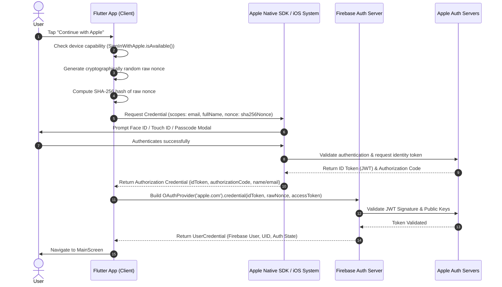

# Apple Sign-In Integration & Workflow Documentation

This document explains the end-to-end workflow, architectural mechanics, cryptographic security steps, Apple Developer configuration, and code implementation of **Apple Login** in the project.

---

## 📌 Executive Summary & Architecture Overview

Apple Sign-In is an OAuth 2.0 / OpenID Connect (OIDC) identity provider system that allows users to authenticate using their Apple ID. In this project, Apple Sign-In is integrated with **Firebase Authentication** and **Flutter (GetX)**.



---

## 🔄 How Apple Sign-In Works (Step-by-Step Breakdown)

### 1. Device Compatibility Check
* **What happens:** The app verifies if the device running the app supports Apple Sign-In (available on iOS 13+, macOS, and supported web browsers).
* **Code Reference:** `SignInWithApple.isAvailable()`

### 2. Cryptographic Nonce Generation (Replay Attack Prevention)
* **What is a Nonce?** A nonce ("number used once") is a cryptographically random token used to prevent replay attacks.
* **Process:**
  1. A 32-character secure random string (`rawNonce`) is generated locally using `Random.secure()`.
  2. A SHA-256 digest of `rawNonce` is computed (`sha256Nonce`).
  3. The `sha256Nonce` is sent to Apple during authentication.
  4. Apple embeds `sha256Nonce` inside the signed JWT identity token.
  5. When authenticating with Firebase, Firebase compares the hash of `rawNonce` with the claim inside the JWT to confirm the token wasn't intercepted or replayed.

### 3. Native Apple Authorization Request
* **Scopes Requested:**
  * `AppleIDAuthorizationScopes.email` (User's email address or Apple Relay Private Email)
  * `AppleIDAuthorizationScopes.fullName` (Given name and Family name)
* **User Authentication:** Apple displays the native sheet (Face ID / Touch ID / Passcode prompt). The user can choose to share their real email or use Apple's **"Hide My Email"** relay service.
* **Important Apple Behavior:** Apple **only provides the user's name and email on the VERY FIRST sign-in**. On subsequent sign-ins, Apple returns only the `userIdentifier` and `identityToken`.

### 4. Apple ID Token & Credential Response
Apple returns an `AuthorizationCredentialAppleID` object containing:
* `identityToken`: A signed JSON Web Token (JWT) issued by Apple containing user claims.
* `authorizationCode`: Short-lived single-use authorization code.
* `userIdentifier`: Unique, stable user ID for this user under your Apple Developer Team.

### 5. Firebase Credential Exchange & Validation
* The app constructs a Firebase `OAuthCredential` using the provider `apple.com`:
  ```dart
  OAuthProvider('apple.com').credential(
    idToken: idToken,
    rawNonce: rawNonce,
    accessToken: appleCredential.authorizationCode,
  );
  ```
* `FirebaseAuth.instance.signInWithCredential(credential)` sends this to Firebase.
* Firebase verifies Apple's cryptographic signature on the JWT via Apple's public key endpoint.
* Firebase creates a new user account (or links an existing one) and issues a standard Firebase Auth session token.

### 6. Application State & Navigation
* Upon successful authentication, GetX state closes loading UI (`EasyLoading.dismiss()`) and routes the user to `MainScreen()`.
* Cancellation (`AuthorizationErrorCode.canceled`) is caught and handled gracefully without alarming the user.

---

## 🛠️ Apple Developer & Firebase Setup Requirements

To make Apple Sign-In work seamlessly in production, the following Apple & Firebase setup is required:

### A. Apple Developer Account Setup
1. **App Identifier (App ID):**
   * Register your Bundle Identifier in the Apple Developer Portal.
   * Enable the **Sign in with Apple** capability under App IDs.
2. **Xcode Configuration:**
   * Open the iOS project in Xcode (`ios/Runner.xcworkspace`).
   * Navigate to **Signing & Capabilities** -> Add **Sign in with Apple** capability.

### B. Firebase Console Configuration
1. Go to **Firebase Console** -> **Authentication** -> **Sign-in method**.
2. Enable **Apple** as a sign-in provider.
3. Fill in required Apple Developer IDs:
   * **Services ID** (for web/android support if needed)
   * **Apple Team ID**
   * **Key ID** & **Private Key (.p8 file)** generated from Apple Developer portal under *Keys*.

---

## 📁 Code Architecture in `paytonpieper` Project

| File Location | Role / Responsibility |
| :--- | :--- |
| [`apple_login_controller.dart`](file:///Users/betopia/kamrul_Project/paytonpieper/lib/features/authentication/controllers/apple_login_controller.dart) | Core GetX Controller handling nonce generation, Apple SDK calls, Firebase authentication, loading states, and error handling. |
| [`auth_common_widgets.dart`](file:///Users/betopia/kamrul_Project/paytonpieper/lib/features/authentication/presentation/widgets/auth_common_widgets.dart#L110-L138) | UI Widget (`AppleSignInButton`) observing loading state and triggering Apple sign-in flow. |
| [`login_screen.dart`](file:///Users/betopia/kamrul_Project/paytonpieper/lib/features/authentication/presentation/screens/login_screen.dart) | Integrates Apple Sign-In button into the login screen flow. |
| [`create_account_screen.dart`](file:///Users/betopia/kamrul_Project/paytonpieper/lib/features/authentication/presentation/screens/create_account_screen.dart) | Integrates Apple Sign-In button into registration flow. |
| [`controller_binder.dart`](file:///Users/betopia/kamrul_Project/paytonpieper/lib/core/bindings/controller_binder.dart#L106-L107) | Registers `AppleLoginController` lazily into GetX dependency injection container. |

---

## 🔒 Security Best Practices Implemented

1. **Secure Nonces:** Always use `Random.secure()` to create nonces for SHA-256 digest hashing before sending to Apple.
2. **User Cancellation Handling:** Catch `SignInWithAppleAuthorizationException` with code `AuthorizationErrorCode.canceled` to avoid showing error dialogs when the user intentionally backs out of the Apple login dialog.
3. **Hide My Email Support:** Ensure backend handles relay addresses (e.g., `@privaterelay.appleid.com`) gracefully.
4. **Token Expiry & Identity Validation:** Delegating validation to Firebase Auth ensures identity tokens are cryptographically validated against Apple's JWKS public keys.
