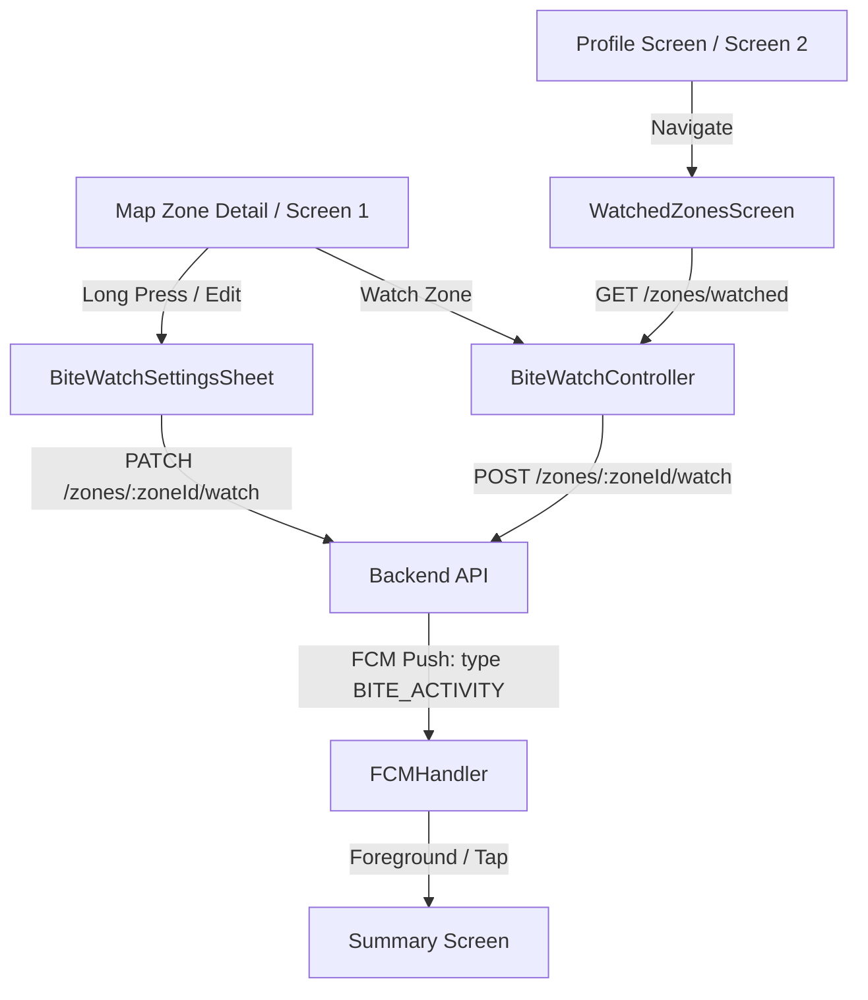

# Bite Watch Alerts — Architecture & Integration Guide

This guide details the end-to-end integration of the **Bite Activity Alerts** feature inside the PaytonPieper Flutter app, including REST API clients, push messaging (FCM), settings bottom sheets, and the central watch dashboard.

---

## 1. Feature Architecture

The Bite Activity Alert system operates using a hybrid Client-Server layout:
- **Server-Side Engine**: Performs the actual activity scoring, monitors catch report volumes, evaluates custom watcher thresholds, enforces 60-minute notification cooldown rules, verifies Pro subscription gates, and pushes alerts via Google Firebase Cloud Messaging (FCM).
- **Client-Side App**: Interacts with the backend REST APIs to subscribe (watch), pause alerts, adjust thresholds, and handle incoming background/foreground push actions to direct the angler to the corresponding zone map/feed details.

---

## 2. API Endpoints Integrated

We have registered the following routes inside [api_constants.dart](lib/core/utils/constants/api_constants.dart):

| Endpoint | Method | Description |
|---|---|---|
| `/zones/:zoneId/watch` | `POST` | Watch a zone with default thresholds (threshold: 3 reports, window: 7 days). |
| `/zones/:zoneId/watch` | `PATCH` | Update alert state or thresholds (e.g. `watchBiteActivity`, `biteThreshold`, `biteThresholdDays`). |
| `/zones/:zoneId/watch` | `DELETE` | Stop monitoring and unwatch the zone. |
| `/zones/watched` | `GET` | Retrieve the collection of active watches with current stats & thresholds. |
| `/users/me/fcm-token` | `PATCH` | Registers the device's FCM messaging token on the server for pushing alerts. |

---

## 3. Frontend Implementation Details

### A. Data Models
- **[BiteWatchModel](lib/features/weather_alerts/model/bite_watch_model.dart)**: Decodes JSON objects from `/zones/watched` list and `/watch` CRUD calls. Formats properties such as `watchBiteActivity`, `biteThreshold`, `biteThresholdDays`, and `lastNotifiedAt`. Includes local persistence serialization methods.

### B. State Management (GetX)
- **[BiteWatchController](lib/features/weather_alerts/controller/bite_watch_controller.dart)**:
  - Connects frontend actions to `NetworkCaller` requests.
  - Automatically loads and saves local fail-safe backups from `StorageService` to handle offline scenarios.
  - Syncs the FCM device token on user authentication or startup.
  - Manages active zone status hooks (`isWatched`, `getWatchFor`).

### C. UI Screens & Components
- **[ZoneMapScreen Bottom Sheet](lib/features/map/screen/zone_map_screen.dart)**:
  - Features a dedicated **Bite Activity Alerts** toggle card underneath the weather alert control.
  - Toggles alerts with a single tap, long-presses to configure thresholds, and displays a lock icon for free subscribers that directs them to the Stripe Pro Upgrade flow.
- **[BiteWatchSettingsSheet](lib/features/weather_alerts/widgets/bite_watch_settings_sheet.dart)**:
  - Features precise sliders and steppers for selecting report counts (1-50 reports) and time windows (1-30 days).
  - Handles key entry dismissals and fits short screen profiles natively.
- **[ProfileMainScreen](lib/features/profile_and_setting/presentation/screen/profile_main_screen.dart)**:
  - Adds a premium orange-themed **Bite Watch Alerts** button card above the Log Out tile.
- **[WatchedZonesScreen Redesign](lib/features/weather_alerts/screen/watched_zones_screen.dart)**:
  - Unifies weather alerts and bite activity alerts into a centralized monitor layout.
  - Displays current thresholds for active features and offers individual edit sheets and unwatch dialog options.

### D. FCM Push Routing
- **[FCMHandler](lib/core/services/firebase/fcm_handler.dart)**:
  - Listens for type `BITE_ACTIVITY` messages.
  - Tapping a push notification parses the `zoneId` from metadata or deep links (`app://zones/{zoneId}`) and navigates the user directly to the target zone summary details screen.

---

## 4. End-to-End Verification Steps

Use the following checklist to verify correct system operation:
1. **FCM Registration**: Start the app, authenticate, check logs for:
   `[FCM] Device token: ...` and `[FCM] Device token registered successfully on server.`
2. **Watch Zone**: Go to Map, tap a zone (e.g. `GOM-0042`), tap **Watch Bite Activity**, confirm success EasyLoading message.
3. **Threshold Config**: Long press the Bite Activity card, increase reports to `5`, save, confirm threshold text updates.
4. **Watched List**: Go to Profile -> tap **Bite Watch Alerts**, verify the zone card appears with active status and threshold labels.
5. **Push Navigation**: Send a mock FCM payload with `type: BITE_ACTIVITY` and `zoneId: GOM-0042`. Tap the push message and ensure the app loads the corresponding zone detail summaries.
