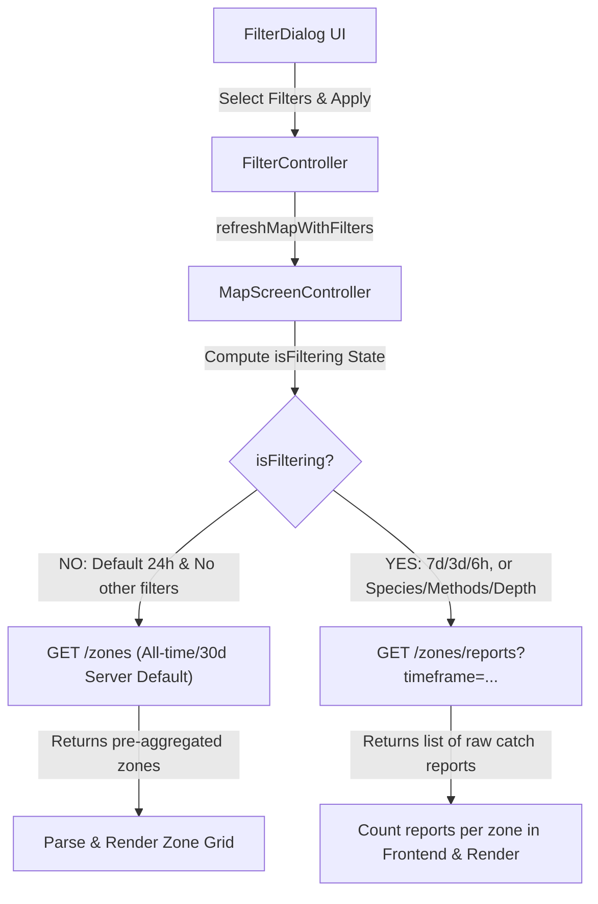

# Map Filtering & Timeframe Behavior Guide

This document explains how map filtering works in the PaytonPieper application, specifically addressing why selecting **7 Days** shows less data than the default **24 Hour** analytics view, and how the API integration behaves.

---

## 1. The "7 Days vs. 24 Hours" Data Paradox Explained

When you launch the map screen, you see a grid showing activity levels (High, Medium, Low) and report counts. 

However, you will notice a difference in data volume:
*   **Default "24h" Selected**: The map shows **many active zones / reports**.
*   **"7d" Selected**: The map shows **fewer active zones / reports**.

### Why does this happen?

The cause is a mismatch between the **Default (Unfiltered) API call** and the **Filtered API call**:

1.  **Unfiltered View (Default - "24h")**:
    *   By default, the time filter is set to `"24h"`. Because this is the default state (and assuming no other filters like species or depth are modified), the system determines that **no filtering is active** (`isFiltering = false`).
    *   When `isFiltering` is `false`, the app calls the **`/zones`** endpoint to fetch pre-aggregated zone data.
    *   **Crucially**, the `/zones` endpoint does not receive a `timeRange` parameter from the app. As a result, the backend server defaults to its own time window, which typically aggregates **all-time reports** or **the last 30 days** of data. 
    *   This is why the map displays a high volume of historical activity.

2.  **Filtered View ("7d", "3d", "6h")**:
    *   When you change the timeframe to `"7d"`, the system detects that filtering is active (`isFiltering = true`).
    *   When `isFiltering` is `true`, the app switches to calling the **`/zones/reports`** endpoint, requesting raw catch reports explicitly filtered by timeframe: `/zones/reports?timeframe=7d`.
    *   This API returns **only individual catch reports created within the last 7 days**. 
    *   The frontend counts these reports and renders them. Because 7 days of raw reports is a much smaller dataset than the server's unfiltered all-time default, **less data is rendered on the UI**.

---

## 2. Technical Filtering Architecture

The filtering state is managed by the `FilterController` and processed by the `MapScreenController` before querying the backend.



### The `isFiltering` Conditional Logic
In [`map_screen_controller.dart`](lib/features/map/controller/map_screen_controller.dart), the logic that determines which endpoint is called is defined as follows:

```dart
isFiltering = (filterController.selectedSpecies.isNotEmpty && !allSpeciesSelected) ||
    (filterController.selectedMethods.isNotEmpty && !allMethodsSelected) ||
    filterController.selectedTime.value.isNotEmpty ||
    filterController.depthValue.value != 625.0 ||
    filterController.selectedVisibilities.length != 1 ||
    !filterController.selectedVisibilities.contains("Public");
```

If **any** of the conditions above are true (including any timeframe selection like `"24h"`, `"7d"`, etc.), the controller treats the query as filtered and invokes `getFilteredRegionReportsApi`.

---

## 3. API Endpoint Mapping

The app uses two different backend endpoints inside [`api_constants.dart`](lib/core/utils/constants/api_constants.dart) depending on the filter state:

| State | API Endpoint | Query Parameters Used | Backend Behavior |
| :--- | :--- | :--- | :--- |
| **Unfiltered** (`isFiltering = false`) | `GET /zones` | `south`, `north`, `west`, `east` | Returns pre-aggregated zone intelligence. Defaults to a large time window (e.g., 30 days/all-time). |
| **Filtered** (`isFiltering = true`) | `GET /zones/reports` | `regionCode=GOM`, `scope=region`, `timeRange`, `species`, `fishingMethod`, `depthMinFt`, `depthMaxFt`, `visibility` | Returns raw list of matching catch reports. Only returns reports within the specified `timeRange` (e.g., last 7 days). |

---

## 4. Current Configuration

We have implemented **Option B: Treat `"24h"` as an active filter**. 

The definition of `isFiltering` treats any non-empty timeframe selection (including `"24h"`) as filtering. This forces the app to call the `/zones/reports?timeframe=...` endpoint for all selected timeframes, guaranteeing timeframe consistency across `"6h"`, `"24h"`, `"3d"`, and `"7d"`.

